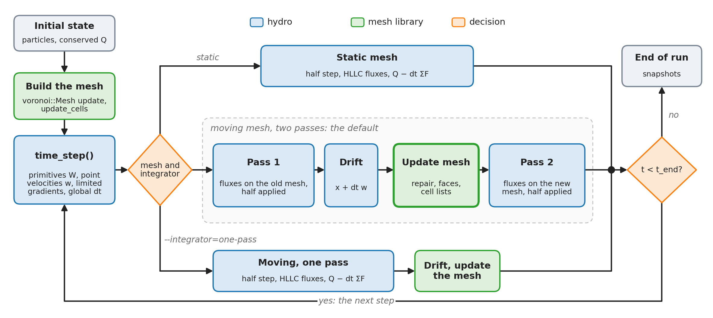

# luna-cpp

Moving-mesh hydrodynamics on GPUs. luna-cpp solves the Euler equations with finite volumes on the exact Voronoi meshes of [voronoi-cpp](https://github.com/Ulli1991/voronoi-cpp), included as a git submodule. The mesh can stay fixed, or move with the gas so that cells follow the flow. It is written in Kokkos C++ and runs on CUDA (tested on an A100 40 GB), with OpenMP and Serial builds of the same code for checks. Every result is measured against LUNA, a static-grid GPU code, as the yardstick.



One run from start to finish. Each step takes a time step, then advances the gas on a static mesh, or on a moving one with fluxes on the old and the new mesh. The green boxes are calls into voronoi-cpp.

BSD 3-Clause, see [LICENSE](LICENSE).

## Where it stands

- **Accuracy:** on shocks and contacts the moving mesh often beats LUNA at the same resolution, because cells follow the gas: sharper contacts on Sod, a smaller error on Shu-Osher and Woodward-Colella, and Sedov's low-density centre resolved down to 10⁻³ where fixed grids stop near 10⁻². On smooth flow the static mesh matches LUNA, and the moving mesh is second order in 3D and 2D but not yet on 1D sound waves ([#23](https://github.com/Ulli1991/luna-cpp/issues/23)).
- **Speed:** in 2D and 3D LUNA is faster per cell update, by 2 to 6 times on the static hydro and more on the moving step; in 1D the two are level, and ours is faster below 4M cells. The moving mesh needs fewer steps (925 against LUNA's 4035 on Sedov at 256³), but not enough fewer to win on GPU time yet.
- **Scale:** 256³ cells fit on one 40 GB A100, moving or static.

## Install and build

```sh
git clone --recursive https://github.com/Ulli1991/luna-cpp.git
```

In an existing clone, run `git submodule update --init --recursive`. `extern/voronoi-cpp` holds the library's full source at a pinned commit, so it can be edited and committed from here. A build warns if the pin is behind voronoi-cpp `main`; the pin moves when luna-cpp needs a newer library (`git submodule update --remote extern/voronoi-cpp`, then commit). `-DLUNA_STRICT_PIN=ON` makes that warning stop the build.

Dependencies:

- CMake 3.16 or later and a C++17 compiler (gcc 14/15 tested).
- Kokkos 5.0 (5.0.2 in CI, 5.0.99 on Raven) with CUDA, OpenMP or Serial. CUDA uses `Kokkos_ARCH_AMPERE80` on an A100, Kokkos' `nvcc_wrapper`, and CUDA 13.0.
- HDF5 (C) for `hydro_sedov`; without it the other targets still build.

CUDA (A100), on Raven:

```sh
module load gcc/14 cuda/13.0 cmake hdf5-serial
cmake -S . -B build-cuda -DCMAKE_BUILD_TYPE=Release \
  -DCMAKE_PREFIX_PATH=/u/uli/kokkos-cuda \
  -DCMAKE_CXX_COMPILER=/u/uli/kokkos-src/bin/nvcc_wrapper -DCMAKE_CXX_EXTENSIONS=OFF
cmake --build build-cuda -j4
```

OpenMP (CPU), on Raven:

```sh
module load gcc/15 cmake hdf5-serial/1.12.2
cmake -S . -B build-omp -DCMAKE_BUILD_TYPE=Release \
  -DCMAKE_PREFIX_PATH=/u/uli/kokkos-gcc15 -DCMAKE_CXX_FLAGS=-march=icelake-server
cmake --build build-omp -j4
```

Elsewhere, point `CMAKE_PREFIX_PATH` at a Kokkos installation with the backend you want. On Raven, build with at most `-j4` on the login node, or inside a Slurm job, and run GPU work through Slurm.

`cmake --build` with no target gives `hydro_sedov`, `hydro_1d`, `hydro_wave3d` and the tests. voronoi-cpp (the submodule) is the mesh library only, so the solver lives here. The CMake targets keep the `luna_` prefix from the split: `luna_hydro_library`, `luna_hydro_sedov`, `luna_hydro_1d`; build one with `--target luna_hydro_1d`.

### Compiler flags in use

- Release: `-O3 -DNDEBUG` (CMake's default), C++17 required (Kokkos sets `-std=c++20`), warnings `-Wall -Wextra -Wpedantic` on the programs.
- CUDA: `nvcc_wrapper` with `-extended-lambda -arch=sm_80`. Kokkos forces `CMAKE_CXX_EXTENSIONS=OFF` for this install and warns unless it is given. Do not set it for the OpenMP build: there the code compiles with `-std=gnu++20`, and `-std=c++20` changes gcc's FP contraction, so the bits.
- OpenMP: `-fopenmp` from Kokkos. The project sets no `-march`; use `-DCMAKE_CXX_FLAGS=-march=icelake-server` on Raven's CPUs.
- `-DCMAKE_EXPORT_COMPILE_COMMANDS=ON` (always on in `CMakeLists.txt`) writes the database clang-tidy needs: `bash scripts/lint_cpp.sh build-omp` (Raven: `module load clang/20`).
- `-DVORONOI_SANITIZERS=ON` adds address and undefined-behaviour sanitizers to a host build.


## Running

```text
hydro_sedov <side> <jittered|uniform> [--moving] [--order=0|1] [--riemann=hllc|hll] [--limiter=face|cell|none]
            [--precision=default|double|grad32|mixed|low|...] [--integrator=one-pass|two-pass] [--bulk=km/s]
            [--out=dir] [--snapshots=10] [--steps=max] [--memory] ...
hydro_kh2d <N> [--moving] [--integrator=one-pass|two-pass] [--out-times=t,...] [--stop-after=<s>] [--resume] ...
hydro_1d <problem> <N> [--moving] [--limiter=face|cell|none] [--dt=luna|arepo|fixed] [--courant=c] ...
hydro_wave3d <sound|simple|vortex|tube> <nx> [--moving] [--integrator=one-pass|two-pass] [--precision=...]
sbatch -o <logs>/hydro-%j.out scripts/hydro_a100.sh build-cuda <out> <mode>
```

`hydro_sedov` needs HDF5 and writes snapshots. Every program prints a loud warning at start if it was built against an older voronoi-cpp than the newest.

## The method

- **Finite volumes on a Voronoi mesh.** `hydro::FiniteVolume<D>` (`src/hydro/finite_volume.hpp`) handles 3D and 2D from one template; 1D has its own fused kernel (`finite_volume_1d.hpp`).
- **MUSCL-Hancock.** Least-squares gradients of the primitive variables, limited at the face centroids as in AREPO, a half step in time, then HLLC (default) or HLL along each face normal, with one global time step.
- **Moving mesh.** Points follow the gas, with a small drift towards their cell centroids that keeps cells round. The mesh is repaired every step, and fluxes go through the moving faces. To stay second order, a moving step takes fluxes on the old mesh and on the new mesh, half each. The code calls this `--integrator=two-pass`, the default; the one-pass option is first order on a moving mesh and will be removed ([#23](https://github.com/Ulli1991/luna-cpp/issues/23)). 1D still uses one pass for now.
- **Precision.** 3D runs `grad32` by default: gradients and limiting in float, everything else in double, 8 to 12 % faster with no measurable loss of accuracy. 2D and 1D run in double.
- **Bit-reproducible.** Every cell sums its faces in a fixed order, so an A100 run gives the same bits every time.

## Results in 1D

All 1D figures are density at the final time, at the resolution named, with zooms on the hard regions. Lines: moving mesh, static mesh, LUNA (MC limiter) and the exact or high-resolution reference.

### Sod shock tube


The standard Riemann problem: a rarefaction, a contact and a shock, N = 512. The moving mesh has the sharpest contact, and 2.5 times LUNA's error at the tail of the rarefaction (x = 0.48). Static lies on LUNA.

### Shu-Osher


A Mach 3 shock running into a sine wave in density, which it compresses into short waves behind it, N = 1024 on LUNA's domain. Moving keeps the left wall at the fixed inflow state and adds cells there as gas enters, 1508 at the end; static and LUNA use a zero-flux wall. Moving resolves the short waves at least as well as LUNA.

### Woodward-Colella


Two blast waves between reflecting walls that collide, N = 2048. Moving holds the contacts and shocks in far fewer cells than LUNA, with one overshoot at x = 0.765.

### Convergence


The error of the reconstructed field against resolution on the three tests. Moving is ahead of LUNA in density on Sod (2 to 13 % behind in pressure), at or below LUNA on Shu-Osher up to 2¹⁷ cells, and ahead on Woodward-Colella, where its density error stalls near 3.4e-4.

### Cost to reach an error


GPU seconds needed to reach a given error. LUNA wins Sod and Shu-Osher, by 7 to 16 times on Shu-Osher, where the moving mesh takes 7.5 times the steps and ends with 1.47 times the cells. Woodward-Colella is close, and only the moving mesh reaches a density error of 1e-3 in the ladder.

## Results in 2D

### Kelvin-Helmholtz instability


Two shearing layers whose interface rolls up into billows (McNally, Lyra & Passy 2012), at t = 0, 1, 2.5, 4 and 5, moving mesh against LUNA, both N = 2048. They agree up to the first roll-up. Past t = 2.5 secondary instabilities set in earlier on the moving billows; neither run is converged there.

### The moving mesh inside a billow


The moving mesh at t = 4 (N = 512): the whole box and three nested zooms into one billow, with the exact Voronoi cells drawn over the density. Cells stretch and gather along the rolled-up layers.

### Density against LUNA


Density at t = 1.0, 1.5, 2.5 and 3.0 for LUNA, static and moving (N = 2048), with the differences from LUNA. Static stays close to LUNA throughout (mean difference 4e-8 at t = 1 to 6e-4 at t = 3). The moving billows stop matching after t = 1.5 (0.012 at t = 2.5).

### Growth of the instability


The error of the instability's growth against the published reference curve, for N² cells. LUNA and static lead at the same N, and LUNA in GPU time. Moving with one pass stalls near 4e-4; with fluxes on both meshes it recovers.

## Results in 3D

### Yee vortex


A smooth isentropic vortex carried for ten time units, the standard test of order on smooth flow. With one pass the moving mesh is first order; with fluxes on both meshes it reaches order 2.2, then 1.5, close to static.

### Sedov blast


A point explosion (1e51 erg, n = 1 cm⁻³, 50 pc box, 1e4 yr). It tests shock capturing and the moving mesh's response to strong expansion, but cannot rank schemes: every code converges below first order (0.66 LUNA, 0.78 moving). Left, density in shells at 128³; right, error against resolution. These moving runs used one pass.

### Sedov at 256³ against LUNA


Shock radius, density profiles at five times and the column density, against LUNA and the Sedov-Taylor solution. The two codes agree to 0.2 % on average, with up to 9 % of the peak at the shock. Both peaks sit below Sedov-Taylor because 256³ is coarse.

### Radial profiles


Density, velocity, pressure and temperature at 1e4 yr. The moving mesh follows Sedov-Taylor down to a density of 10⁻³ in the evacuated centre, where both fixed grids level off near 10⁻².

### The mesh at the shell


A slice through the 3D mesh at 1e4 yr. The moving cells gather in the shell and open up behind it; the static mesh stays uniform.

## Speed

Measured on one A100 at 1305 MHz, Sedov 3D, 40 steps, LUNA in the same job. G cell updates per second; jobs and the remaining rows are in [docs/measurements.md](docs/measurements.md).

| G cell updates/s | 128³ | 256³ |
|---|---|---|
| static mesh, HLLC | 0.170 | 0.166 |
| moving mesh, whole step with the mesh update | 0.072 | 0.076 |
| LUNA, MC, HLLC, FP64 | 0.47 to 0.76 | 0.87 |
| LUNA, FP32 | 0.68 | 1.74 |
| device memory, moving | 2255 B/cell | 2255 B/cell |
| device memory, LUNA FP64 | 0.22 GB | 1.25 GB |

### Against resolution


Speed and memory from 32³ to 256³. The hydro is flat from 96³ up; below 64³ the fixed cost per step dominates.

### Precision options


The same sweep for each precision option. The default `grad32` gains 12 % on the static hydro and 8 % on the moving step against double; `grad16` gains a few percent more. None of ours is FP32 throughout, so LUNA's FP32 line is not a like-for-like comparison. `grad32` leaves the error against exact solutions unchanged to four digits on every test checked.

### 1D, 2D and 3D


The same blast in each dimension. At the largest size the static hydro runs 2.66, 0.67 and 0.15 G cell updates/s against LUNA's 2.96, 1.46 and 0.95: level in 1D, LUNA 2.2 times ahead in 2D and 6.4 times in 3D, roughly in line with the number of faces per cell. Our 1D is faster than LUNA up to 4M cells.

## Tests

Run times are in [TESTING.md](TESTING.md). The mesh's own tests are in voronoi-cpp.

| Test | Specifies |
|---|---|
| `hydro` | HLLC and HLL fluxes, conservation, bit-identical runs, moving-mesh invariances (bulk velocity, Galilean blast) |
| `hydro_wave` | moving 3D step on smooth flow, both integrators: Yee's vortex and a sound wave against measured bounds |
| `hydro2d` | 2D hydro, static and moving: uniform states, conservation, sound-wave order, Sod, Noh, a Galilean blast |
| `hydro1d` | 1D hydro: conservation, inflow, cells from a wall with the budget through it, Sod against the exact solution; LUNA's final states of Sod, Shu-Osher and Woodward-Colella at N = 16 to 1e-12 |

```sh
ctest --test-dir build-cuda --output-on-failure
OMP_NUM_THREADS=1 ctest --test-dir build-omp
```

CI (`.github/workflows/checks.yml`) runs clang-tidy and the CPU tests in ordinary and sanitizer builds against a pinned Serial Kokkos 5.0.2, with the submodule checked out. It does not run GPU jobs.


## Limitations

- **Speed.** The hydro step is below its target of 0.3 G cell updates/s static. It waits on memory, not arithmetic: the kernels spend 61 to 98 % of their time waiting for loads, and the gradient sweep is the slowest.
- **1D moving mesh:** sound waves are first order and then stall near 1e-5 ([#23](https://github.com/Ulli1991/luna-cpp/issues/23)); Woodward-Colella stalls near N = 2¹⁵; nothing removes points where gas leaves through an open wall.
- **Boxes:** periodic only in 3D and 2D; only 1D has walls.
- **Memory:** `--precision=mixed` does not fit a moving 256³ run on a 40 GB A100; a forced rebuild beside a moving 256³ run runs out of memory ([#11](https://github.com/Ulli1991/luna-cpp/issues/11)).
- **Bits:** CPU builds can differ from the GPU in the last bits for some modes; A100 runs are identical run to run.
- **Open bugs:** stuck flips at 256³ ([#8](https://github.com/Ulli1991/luna-cpp/issues/8)); NaN from zero-area faces on an exact lattice ([#6](https://github.com/Ulli1991/luna-cpp/issues/6)). Mesh bugs are listed in the [voronoi-cpp README](https://github.com/Ulli1991/voronoi-cpp#limitations-and-open-items).

## Roadmap

Done: 3D, 2D and 1D hydro on the exact mesh, second order on moving meshes in 3D and 2D, a first round of speed work, `grad32` in 3D.

1. One `main` and one general runner for 1D, 2D and 3D, reading a LUNA-style parameter file ([#18](https://github.com/Ulli1991/luna-cpp/issues/18)).
2. One scheme everywhere: MUSCL-Hancock with fluxes on the old and new mesh when the mesh moves, including 1D, and no one-pass option ([#23](https://github.com/Ulli1991/luna-cpp/issues/23)).
3. Hydro speed: towards 0.3 G cell updates/s static, starting with faces numbered by owner and fewer registers in the gradient sweep.
4. A standing 3D test suite against LUNA ([#7](https://github.com/Ulli1991/luna-cpp/issues/7)).
5. Time integration study: RK2 with PLM against MUSCL-Hancock, and how the mesh should move within a step ([#1](https://github.com/Ulli1991/luna-cpp/issues/1)).
6. Local time steps ([#9](https://github.com/Ulli1991/luna-cpp/issues/9)), multi-GPU, refinement, self-gravity, and autodiff ([#12](https://github.com/Ulli1991/luna-cpp/issues/12)).

More ideas, each with a first test: [docs/ideas.md](docs/ideas.md).

## Repository layout

- `src/hydro/`: the solver, header-only: `precision.hpp`, `euler.hpp` (gas and fluxes), `finite_volume.hpp` (2D and 3D), `finite_volume_1d.hpp`, and the initial conditions and snapshots.
- `src/bench/`: the programs `hydro_sedov`, `hydro_1d`, `hydro_wave3d`, `hydro_kh2d`.
- `src/test/`: the tests.
- `extern/voronoi-cpp/`: the mesh library, a pinned submodule with its full source.
- `scripts/`: run scripts for the A100, figure scripts (`make_figures.py`, LUNA's `figstyle.py`), lint.
- `docs/`: figures, `design.md`, `measurements.md`, `ideas.md`.
