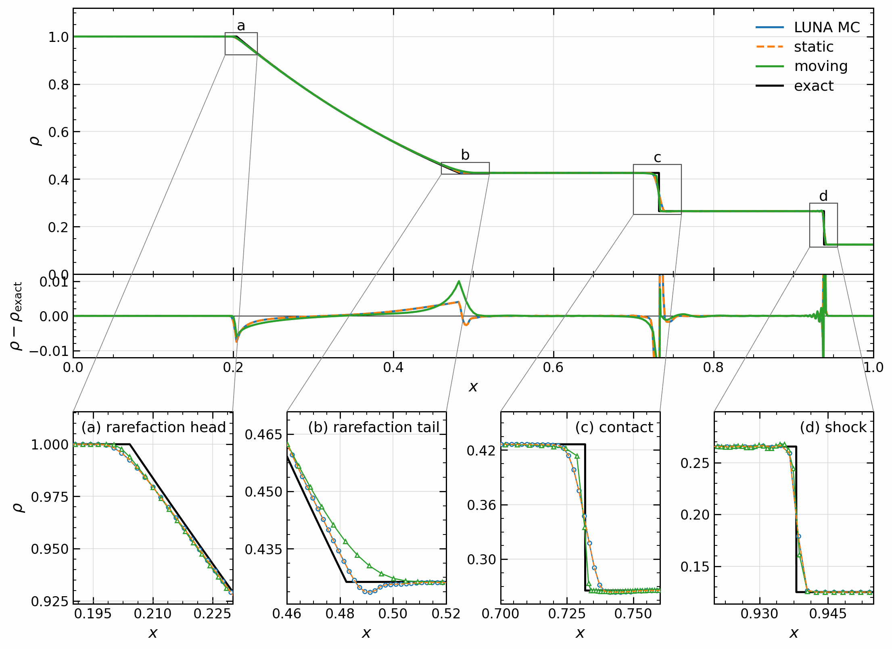
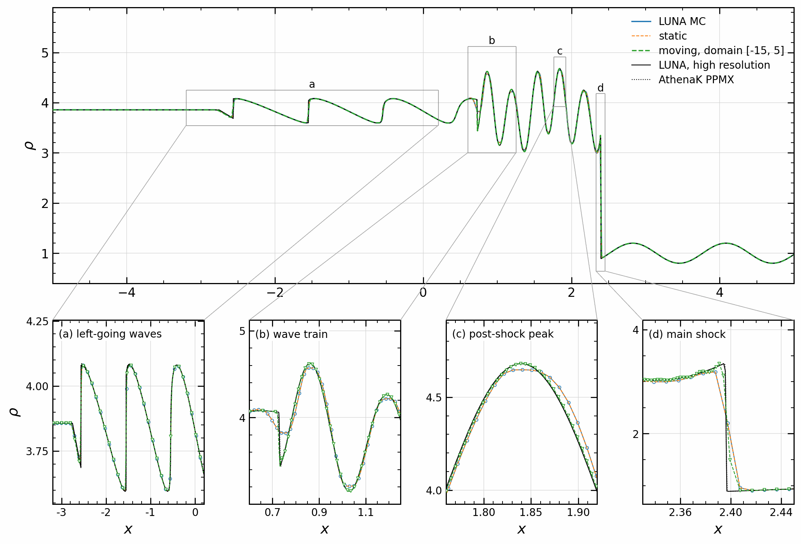
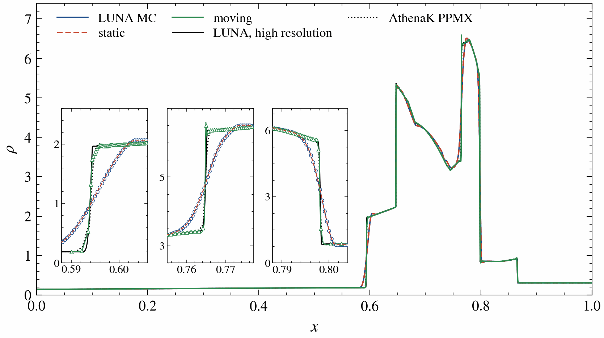
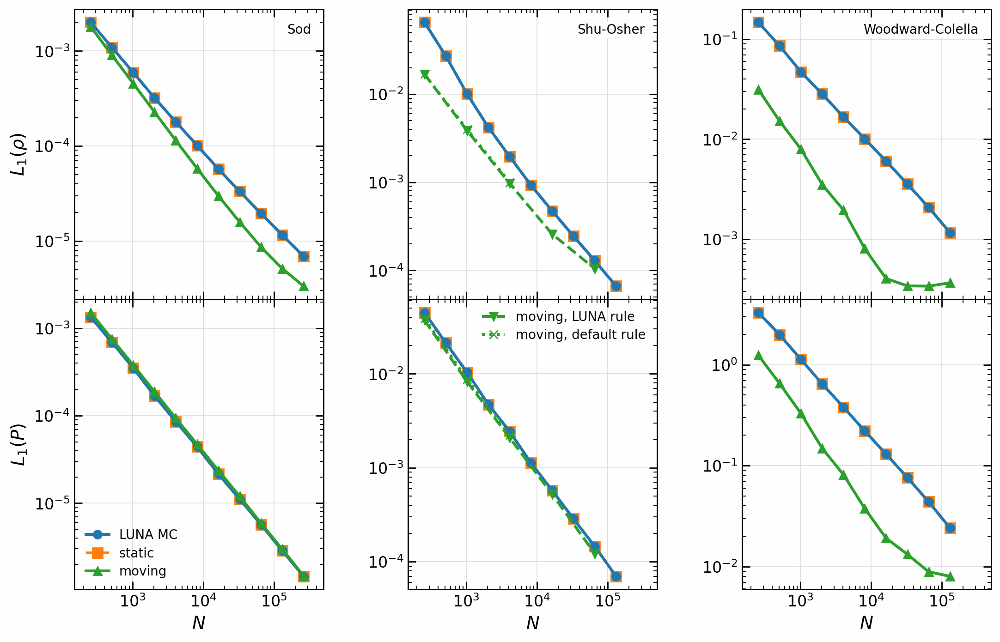
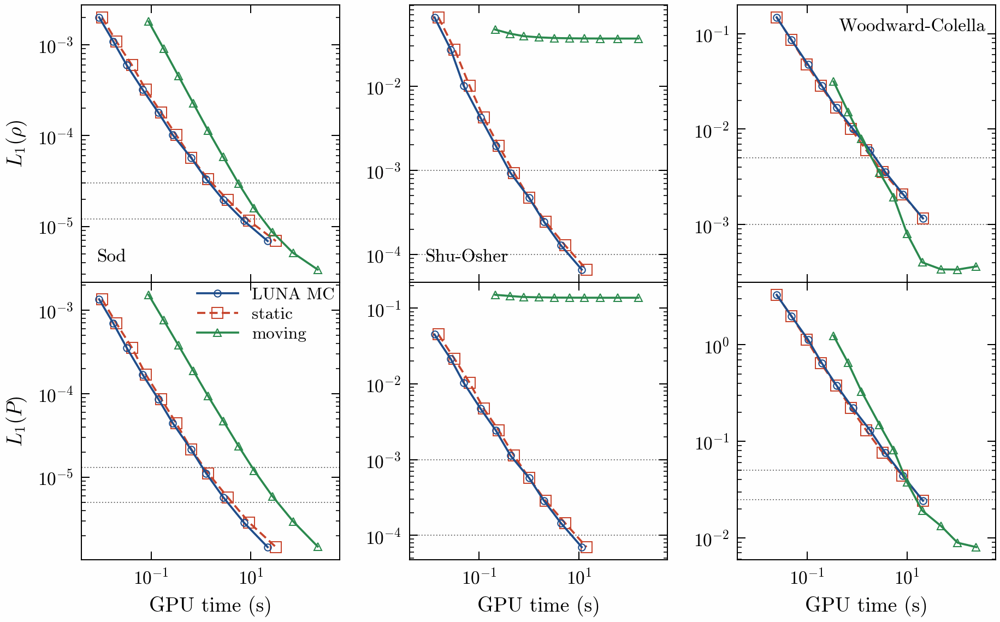
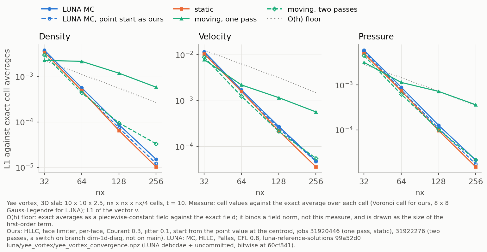
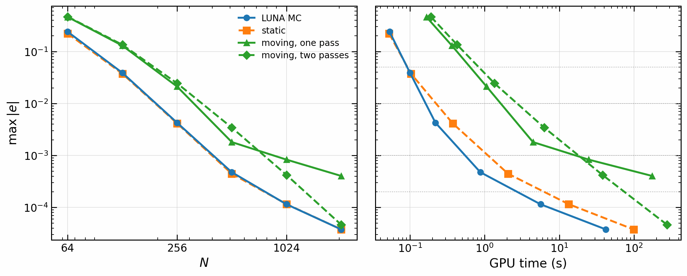
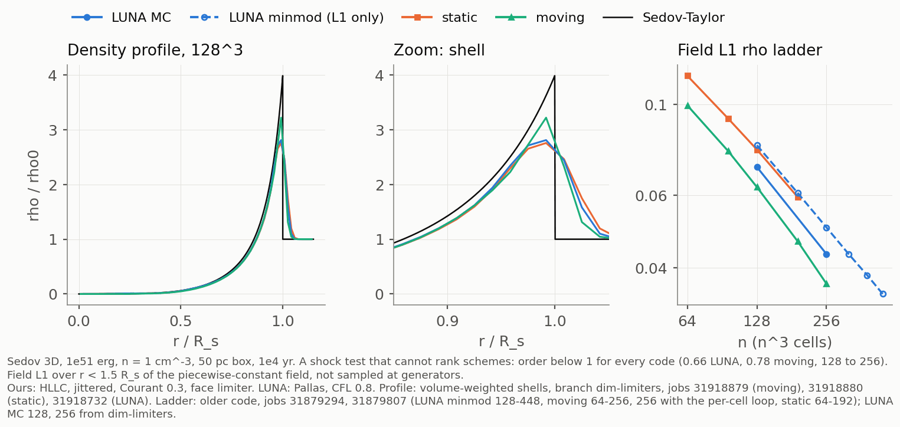

# luna-cpp

Moving-mesh finite-volume hydro in Kokkos C++ on GPUs (CUDA, validated on an A100 40 GB; OpenMP and Serial builds run
the same code for checks), on the exact Voronoi meshes of
[voronoi-cpp](https://github.com/Ulli1991/voronoi-cpp), which it includes as a git submodule.

MUSCL-Hancock with HLLC or HLL (on a moving mesh AREPO next generation's two flux passes), AREPO-style least-squares
gradients and mesh regularisation, on a static or moving mesh, bit-reproducible run to run, in 3D (periodic boxes) and 1D (with walls). On Sedov 3D the moving mesh is more
accurate than the static mesh at the same resolution in 4.6x fewer steps (see "The hydro").

BSD 3-Clause, see [LICENSE](LICENSE).

## Install and build

```sh
git clone --recursive https://github.com/Ulli1991/luna-cpp.git
```

(In an existing clone: `git submodule update --init --recursive`.)

A build stops if `extern/voronoi-cpp` is behind voronoi-cpp `main`: update the pin and commit it. `-DLUNA_ALLOW_OLD_PIN=ON` only warns, to reproduce an old result.

Dependencies:

- CMake 3.16 or later, a C++17 compiler (gcc 14/15 tested).
- Kokkos 5.0 (5.0.2 in CI, 5.0.99 on Raven) with the backend you want: CUDA (A100: `Kokkos_ARCH_AMPERE80`, compiled
  through Kokkos' `nvcc_wrapper`; CUDA 13.0 tested), OpenMP or Serial.
- HDF5 (C) for `hydro_sedov`; without it the other targets still build.

CUDA (A100), on Raven:

```sh
module load gcc/14 cuda/13.0 cmake hdf5-serial
cmake -S . -B build-cuda -DCMAKE_BUILD_TYPE=Release \
  -DCMAKE_PREFIX_PATH=/u/uli/kokkos-cuda \
  -DCMAKE_CXX_COMPILER=/u/uli/kokkos-src/bin/nvcc_wrapper -DCMAKE_CXX_EXTENSIONS=OFF
cmake --build build-cuda -j4
```

OpenMP (CPU), on Raven:

```sh
module load gcc/15 cmake hdf5-serial/1.12.2
cmake -S . -B build-omp -DCMAKE_BUILD_TYPE=Release \
  -DCMAKE_PREFIX_PATH=/u/uli/kokkos-gcc15 -DCMAKE_CXX_FLAGS=-march=icelake-server
cmake --build build-omp -j4
```

Elsewhere, point `CMAKE_PREFIX_PATH` at a Kokkos installation with the desired backend. On Raven, build at most with
`-j4` on the login node, or inside a Slurm job; run GPU work through Slurm.

`cmake --build` with no target gives `hydro_sedov`, `hydro_1d`, `hydro_wave3d` and the tests. The pinned voronoi-cpp still holds its
own copy of the hydro, so the CMake targets here are `luna_hydro_library`, `luna_hydro_sedov` and `luna_hydro_1d`; to
build one program use those names (`--target hydro_1d` would build the submodule's copy).

### Compiler flags in use

- Release: `-O3 -DNDEBUG` (CMake's default), C++17 required (Kokkos sets `-std=c++20`), warnings
  `-Wall -Wextra -Wpedantic` on the programs.
- CUDA: `nvcc_wrapper` with `-extended-lambda -arch=sm_80` (from Kokkos' AMPERE80). Kokkos forces
  `CMAKE_CXX_EXTENSIONS=OFF` for this install and warns unless it is given. Do not set it for the OpenMP build: there
  the code compiles with `-std=gnu++20`, and `-std=c++20` changes gcc's FP contraction, so the bits.
- OpenMP: `-fopenmp` from Kokkos; no `-march` is set by the project (`-DCMAKE_CXX_FLAGS=-march=icelake-server` on
  Raven's CPUs).
- `-DCMAKE_EXPORT_COMPILE_COMMANDS=ON` (always on in `CMakeLists.txt`) writes the compilation database clang-tidy
  needs: `bash scripts/lint_cpp.sh build-omp` (Raven: `module load clang/20`).
- `-DVORONOI_SANITIZERS=ON` adds address and undefined-behaviour sanitizers to a host build.

## Tests

Details and run times are in [TESTING.md](TESTING.md). The mesh's own tests are in voronoi-cpp.

| Test | Specifies |
|---|---|
| `hydro` | HLLC and HLL against reference fluxes and under rotation; uniform states stay uniform, conservation to rounding, bit-identical runs, the two update loops agree to rounding on jittered and uniform meshes; moving mesh: uniform state with a bulk velocity, conservation, Galilean invariance of a moving blast |
| `hydro_wave` | the moving 3D step on smooth flow, both integrators: Yee's vortex (jitter 0.1) and a sound wave (jitter 0.25), L1 of rho, v, P and the rate of rho against measured bounds; two passes keep second order where one pass loses it |
| `hydro1d` | the 1D hydro: uniform states, conservation, bit-identical runs, inflow; Sod against the exact solution, static and moving; LUNA's final states of Sod, Shu-Osher and Woodward-Colella at N = 16 to 1e-12 |

```sh
ctest --test-dir build-cuda --output-on-failure
OMP_NUM_THREADS=1 ctest --test-dir build-omp
```

CI (`.github/workflows/checks.yml`) runs clang-tidy and the CPU tests in ordinary and sanitizer builds against a
pinned Serial Kokkos 5.0.2, with the submodule checked out; it does not run GPU jobs.

## The hydro

`hydro::FiniteVolume` (`src/hydro/`) runs finite volumes on a static or
moving `voronoi::Mesh` (moving: the points follow the flow with a drift
towards the cell centroids, the mesh is repaired every step, fluxes go
through the moving faces): extensive conserved state only between steps, least-squares
gradients of the primitives limited at the face centroids, MUSCL-Hancock
half step, HLLC (default) or HLL along each face normal, one global time
step (Courant factor 0.3 on each cell's radius and signal speeds); order 0
is first-order Godunov. Every cell sums over its face list in a fixed
order, so runs are bit-reproducible. Two update loops: per face (a face
flux array, then a per-cell gather; default at second order) or per cell
(each face flux computed from both sides; default at first order).

On a moving mesh at order 1 the default integrator is AREPO next generation's two passes: fluxes on the mesh of the
start of the step, half applied, the mesh update, fluxes on the new mesh from the same primitives and gradients advanced
a whole step, half applied. `--integrator=one-pass` selects the MUSCL-Hancock step of the static mesh there, with the
bits it had before (hash in research_notes/two_pass_2026-11-05.md). The numbers below that a moving run gives are for the
integrator named in each; costs and accuracy of the two side by side are in that note.

```text
hydro_sedov <side> <jittered|uniform> [--order=0|1] [--update=cell|face] [--limiter=face|cell|none]
            [--riemann=hllc|hll] [--precision=default|mixed|low|...] [--moving] [--bulk=km/s] [--out=dir] [--snapshots=10] [--steps=max] [--input-order] [--memory]
            [--integrator=one-pass|two-pass]
hydro_wave3d <sound|simple|vortex|tube> <nx> [--moving] [--integrator=one-pass|two-pass] [--jitter=spacings] [--out=file.npy]
sbatch -o <logs>/hydro-%j.out scripts/hydro_a100.sh build-cuda <out> <mode> (see the script)
```

`hydro_sedov` (needs HDF5; on Raven `module load hdf5-serial`) runs a
Sedov blast (1e51 erg, n = 1 cm^-3, 50 pc box, 1e4 yr) and writes HDF5
snapshots. Measured on one A100, double, jittered points in Morton order,
median of 40 steps. The 2.1M column is current (static job 31879405, moving jobs 31925156 and
31925157, HLLC rows; the same code varies by about 10 % between GPU jobs). In the 16.8M
column the moving rows are current (job 31925157, 1305 MHz); the static rows and the
HLL and first-order rows are the earlier code (jobs 31699864, 31699865,
31700852, kept until they are re-measured):

| Million cell updates per second | 2,097,152 cells | 16,777,216 cells |
|---|---|---|
| moving mesh, two passes (default), HLLC, per-face loop (mesh update and face lists included) | **66** | 68 (whole run) |
| moving mesh, one pass, same | 84 | 88 (whole run) |
| static mesh, MUSCL-Hancock HLLC, per-face loop | **152** | 105 |
| static mesh, MUSCL-Hancock HLL, per-face loop | 116 | 114 |
| static mesh, first order HLLC, per-cell loop | 288 | 290 |
| device memory, mesh + hydro (static, per-face, second order) | 2434 B/cell | 2371 B/cell (41.2 GB in use) |
| device memory, moving mesh + hydro, two passes (per-face) | 2319 B/cell | 2319 B/cell (40.5 GB in use, whole run); `--precision=mixed` 2445 B/cell, does not fit at 256^3, see Limitations |
| device memory, moving mesh + hydro, one pass (per-face) | 2298 B/cell | 2298 B/cell (40.1 GB in use, whole run); `--precision=mixed` 2334 B/cell (40.7 GB, job 31925336) |

Sedov at 128^3 (job 31699863; the moving numbers of this paragraph are one pass), HLLC: shock radius 0.978 of the
Sedov-Taylor value at 1e4 yr, L1 density error 0.075 rho0 (first order:
0.104); mass and energy conserved to 2e-16. On the moving mesh (jobs
31700850-51): 354 steps instead of 1642, L1 density error 0.058 rho0, the
same numbers with the whole box moving at 500 km/s; at 256^3 L1 0.034 in
288 s of GPU time (job 31702077; now 176 s, job 31925157, two passes 230 s). These L1 values are sampled at
the mesh generators, which flatters a moving mesh; the field L1 (the integral
of |rho_h - rho| dV) is the fair norm and is what the test suite will report
(research_notes/accuracy_score_exploration_2026-11-04.md). Details:
research_notes/hydro_stage1_2026-10-31.md, hydro_stage3_2026-10-31.md. Field L1 of density, r < 1.5 R_s (one pass, two
passes): 128^3 0.0629, 0.0648; 256^3 0.0369, 0.0377 (research_notes/two_pass_2026-11-05.md).

### 1D (`hydro_1d`, `finite_volume_1d.hpp`)

`hydro::FiniteVolume<1, Exec, Riemann>` on `voronoi::Mesh<1>`, static or
moving, with walls (reflective, zero gradient, inflow). The whole step is one
kernel. Defaults: a static run uses Courant x V / (|v| + c) at 0.8, one launch
per step that also finds the next time step (`step_and_time_step`); a moving
run uses AREPO next generation's rule with its pair term at 0.4 (r = V / 2 in
1D), three launches (time step, step, order check). 3D stays at 0.3. On a
uniform static line the scheme is second-order MUSCL-Hancock with the MC
limiter. Points are regularised as
AREPO next generation does without a face angle: a drift towards the
density-displaced centroid when it is more than 0.75 cell radii away.

M cell updates/s, one A100 40 GB at 1305 MHz (ravg1002, job 31917211, Sod,
HLLC, 2000 steps, 200 at 2^24; hydro only is a static step, whole step a
moving one at its defaults with the order check):

| cells | 4,096 | 65,536 | 1,048,576 | 16,777,216 |
|---|---|---|---|---|
| hydro only | 81 | 948 | 2810 | 3226 |
| whole moving step | 48 | 636 | 1872 | 2297 |

Below ~1e5 cells a step is bound by launch latency (~60 us), not by the
kernel. Peak device memory: 144 B/cell static, 152 B/cell moving. Runs are
bit-reproducible (the hash of the final state and positions). Field accuracy on Sod, Shu-Osher and Woodward-Colella:
research_notes/stage1_1d_2026-11-04.md.

## Figures

From `scripts/make_figures.py`, in LUNA's figure style (`scripts/figstyle.py`).



Sod, t = 0.25, N = 512, cell means at centroids against the exact solution; the boxes mark the zooms, open markers are cells (static lies on LUNA, drawn dashed). Moving has the sharper contact and 2.5 times LUNA's error at the tail of the rarefaction (x = 0.48); the strip clips the contact and shock spikes. HLLC, MUSCL-Hancock, FP64; LUNA: MC, Pallas, CFL 0.8; static: uniform points, face limiter, LUNA's time step rule at 0.8; moving: face limiter, the default rule at 0.4, regularised. Job 31917206, voronoi-cpp 947946a.



Shu-Osher, t = 1.8, N = 1024 on [-5, 5]. Top: on LUNA's domain moving fails: the grown inflow cell flattens the waves (job 31917208, 947946a, runs as for Sod). Middle: padded domain [-15, 5], same cell width: moving follows the reference, at the default rule at 0.3 (0.4 was not run padded), OpenMP, job 31920121, branch dim-1d-diag. Bottom: zooms of the regions marked above, open markers a regular subset of the cells where they would touch. Curves: luna-reference-solutions 99a52d0, `luna/shu_osher/shu_osher_mc.npz` (LUNA b7b0d35, MC HLLC, 65536 on 8192 cells), `athenak/shu_osher/so_ppmx_rk4_16384.npz` (AthenaK c52f88f).



Woodward-Colella, t = 0.038, N = 2048, reflecting walls; zooms on each contact and shock, open markers a regular subset of the cells where they would touch. Moving holds them in far fewer cells than LUNA, with an overshoot at x = 0.765. Job 31917210, 947946a, runs as for Sod. Curves: luna-reference-solutions 99a52d0, `luna/woodward_colella/woodward_colella_mc.npz` (LUNA b7b0d35, MC HLLC, 65536 on 8192 cells), `athenak/woodward_colella/a9_ppmx_rk4_16384.npz` (AthenaK c52f88f).



Field L1 of the reconstructed field (`scripts/compare_1d.py`), against the exact solution on Sod, LUNA MC 2^21 cells on Shu-Osher, LUNA MC 2^20 cells on Woodward-Colella. Sod: moving ahead of LUNA in rho, 2-13 % over it in P. Shu-Osher: a floor at 0.037 on LUNA's domain, padded runs (norm on [-5, 5], N per length 10) at LUNA's level: LUNA's rule 0.4, job 31919016, default rule at 0.3, job 31920121, branch dim-1d-diag. Woodward-Colella: ahead of LUNA, with a stall near 3.4e-4 in rho. Jobs 31917206/8/10, 947946a.



GPU seconds of the stepping loop, one A100, one point per N, dotted lines the targets of the notes; LUNA's compile not counted, below ~1e5 cells a step is launch latency. LUNA wins Sod and Shu-Osher, where moving reaches no target. On Woodward-Colella it is close in rho and P, and only moving reaches rho 1e-3 in the ladder. One job per test: Sod 31917206, Shu-Osher 31917208 at 1095 MHz, Woodward-Colella 31917210 at 1305 MHz, 947946a.



Yee vortex in a 3D slab, 10 x 10 x 2.5, nx x nx x nx/4 cells, t = 10. L1 of cell values against the exact average over each cell, v the vector. Moving one pass is first order; two passes (now the default) reach order 2.2, then 1.5, and stay above static. O(h) floor: exact averages as a piecewise-constant field against the exact field; it binds a field norm, not this measure. Ours: HLLC, face limiter, Courant 0.3, jitter 0.1, start from the point value at the centroid, jobs 31920446, 31922276. LUNA: MC, HLLC, Pallas, CFL 0.8, luna-reference-solutions 99a52d0 `luna/yee_vortex/yee_vortex_convergence.npz` (LUNA debcdae + uncommitted, bitwise at 60cf841).



Kelvin-Helmholtz after McNally, Lyra & Passy (2012), N^2 cells, one A100 at 1305 MHz; e(t) = M / M_ref - 1 against their published reference curve, max over t <= 1.5, dotted lines the targets. LUNA and static lead at equal N, LUNA in GPU time; one-flux moving stalls near 4e-4, two fluxes recover. All HLLC, FP64; LUNA MC, Pallas, CFL 0.8; ours face limiter, per-face, LUNA's rule 0.8. Jobs 31922404/5/6, voronoi-cpp branch dim-2d: this hydro is not yet on luna-cpp main.



Sedov 3D, 1e51 erg, n = 1 cm^-3, 50 pc box, 1e4 yr: a shock test that cannot rank schemes, order below 1 for every code (0.66 LUNA minmod, 0.78 moving, n = 128 to 256). Left: volume-weighted shells at 128^3 with zooms on the shell and the shock front, markers are shells, not cells, branch dim-limiters, jobs 31918879 (moving), 31918880 (static), 31918732 (LUNA). Right: field L1 over r < 1.5 R_s of the piecewise-constant field, not sampled at generators; older code, jobs 31879294, 31879807 (LUNA minmod 128-448, moving 64-256, 256 with the per-cell loop, static 64-192), LUNA MC 128 and 256 from dim-limiters. Ours: HLLC, jittered, Courant 0.3, face limiter; moving is one pass in all these runs, older than the two-pass default.

## Limitations and open items

- The hydro step is not yet at its target (~300 M cell updates/s): on the A100 at 128^3 double precision runs at
  152 M cell updates/s static, its hydro part at 140 M cells/s on a moving mesh (one pass), the whole moving step at
  84 M cell updates/s with one pass, 66 with two. Compile-time precision options (`--precision=`, default double): mixed +10 %, low +19 % on the
  hydro static, +4 % / +7 % on the whole moving step with one pass (research_notes/hydro_speed_2026-11-04.md).
- Moving 256^3 on a 40 GB A100: two passes in double fit (2319 B/cell, 40484 of 42405 MB in use); with `--precision=mixed`
  they do not (2445 B/cell, about 42.6 GB needed): use `--integrator=one-pass` there, or `--precision=grad32`
  (2255 B/cell). The double area and centroid arrays stay beside mixed's float face rows.
- On the CPU (gcc's default FP contraction) some hydro modes differ from the GPU in the last bits; the A100 runs are
  bit-identical run to run.
- Periodic boxes only in 3D; only 1D has walls.
- 1D moving mesh, inflow: no refinement, so the gas that enters from an inflow wall fills a few grown cells. That gas
  is not uniform in general (Shu-Osher: acoustic waves cross it), so the error there does not converge.
- 1D moving mesh: the error of Woodward-Colella stops falling near N = 2^15, at every Courant number tried
  (research_notes/stage1_1d_2026-11-04.md).

## Roadmap

1. Hydro speed, first round done: 107 -> 152 M cell updates/s static double, 56 -> 73 for the whole moving step (one pass). The
   remaining limit is memory waits in the gradient sweep; sliced lists, 16-bit offsets, tiles and a face-major update
   did not help (research_notes/hydro_speed_2026-11-04.md).
2. 2D hydro on voronoi-cpp's 2D mesh; Kelvin-Helmholtz after McNally, Lyra & Passy (2012).
3. Multi-GPU hydro, on the mesh's domain decomposition and ghost layers (voronoi-cpp).
4. Refinement and derefinement: conservative remap from the volumes, on the mesh's split and merge.
5. Self-gravity by multigrid, after the hydro suite passes at speed, starting from LUNA's gravity solvers (same author;
   multigrid with coarse-grid gather): V-cycles warm-started from the previous step's potential, aiming at 2-4
   V-cycles per step, so the solve runs at full GPU speed. Options: an auxiliary Cartesian grid (deposit, solve,
   interpolate) or multigrid on the Voronoi mesh itself with gravity as face fluxes. Coarse levels are inefficient on
   GPUs (too little work per launch), so they can run on the host CPUs: fine levels on the GPU, levels below a size
   threshold on the CPU, one small transfer each way per V-cycle
   (research_notes/multigrid_moving_mesh_literature_2026-11-02.md).

Every test in the suite reports accuracy per cost: GPU-seconds to a target error at 2-3 resolutions.

## Repository layout

- `src/hydro/`: the hydro (header-only). `src/bench/`: `hydro_sedov`, `hydro_1d`, `hydro_wave3d`. `src/test/`: the tests,
  `exact_riemann.hpp`, `luna_1d_values.hpp`.
- `extern/voronoi-cpp/`: the mesh library, pinned submodule.
- `scripts/`: `hydro_a100.sh`, `hydro_speed_a100.sh`, `dim1d_a100.sh`, `two_pass_a100.sh`, `snapshot_hash.sh`, `compare_1d.py`,
  `hydro_sedov_compare.py`, `sedov_field_l1.py`, `norm3d.py`, `luna_*.py`, `make_figures.py`, `figstyle.py`, `lint_cpp.sh`.
- `docs/figures/`: the figures.
- `research_notes/`, `reports/`: status notes.
