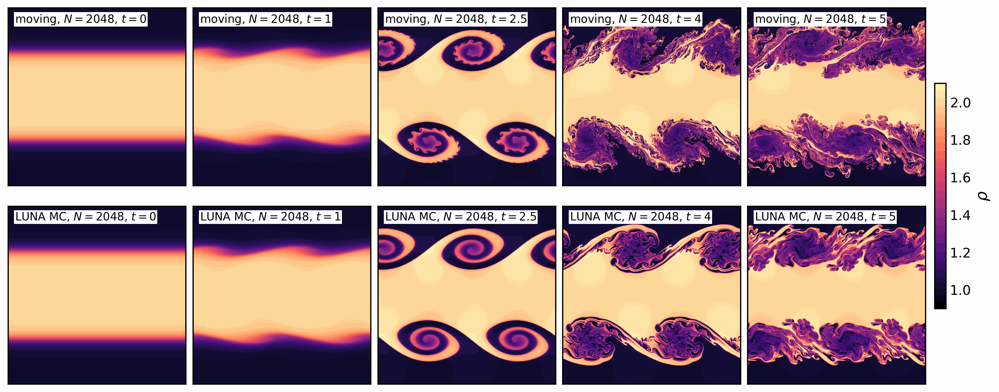
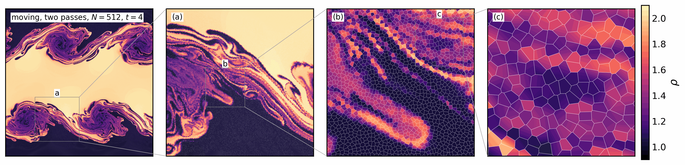
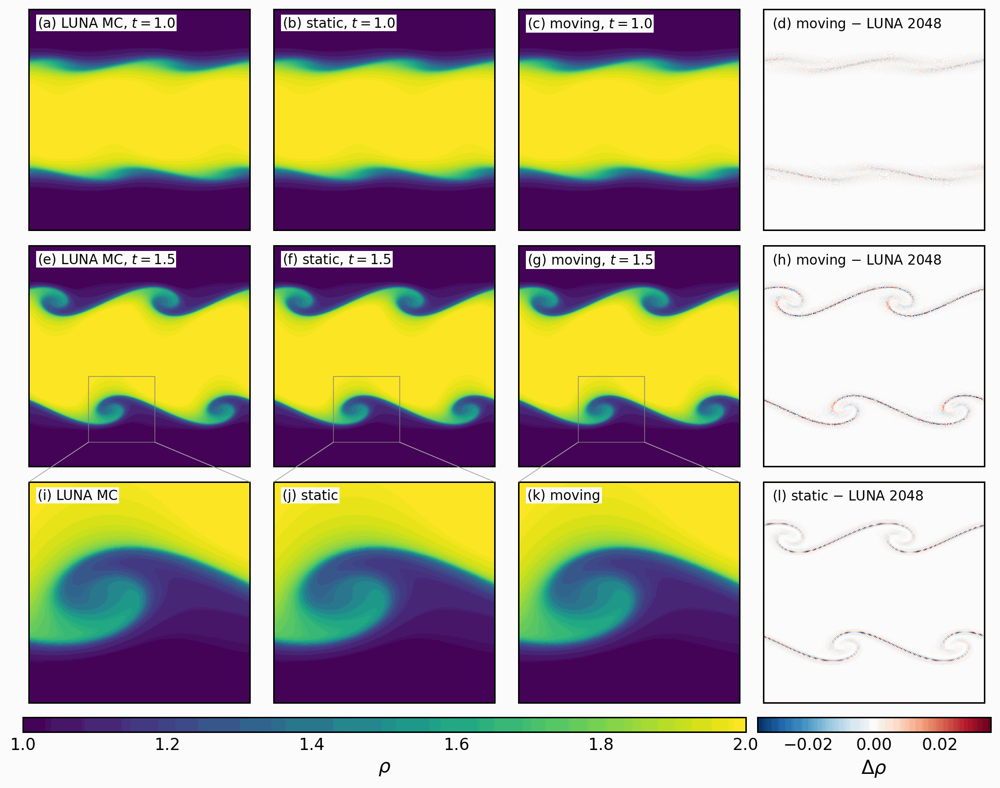
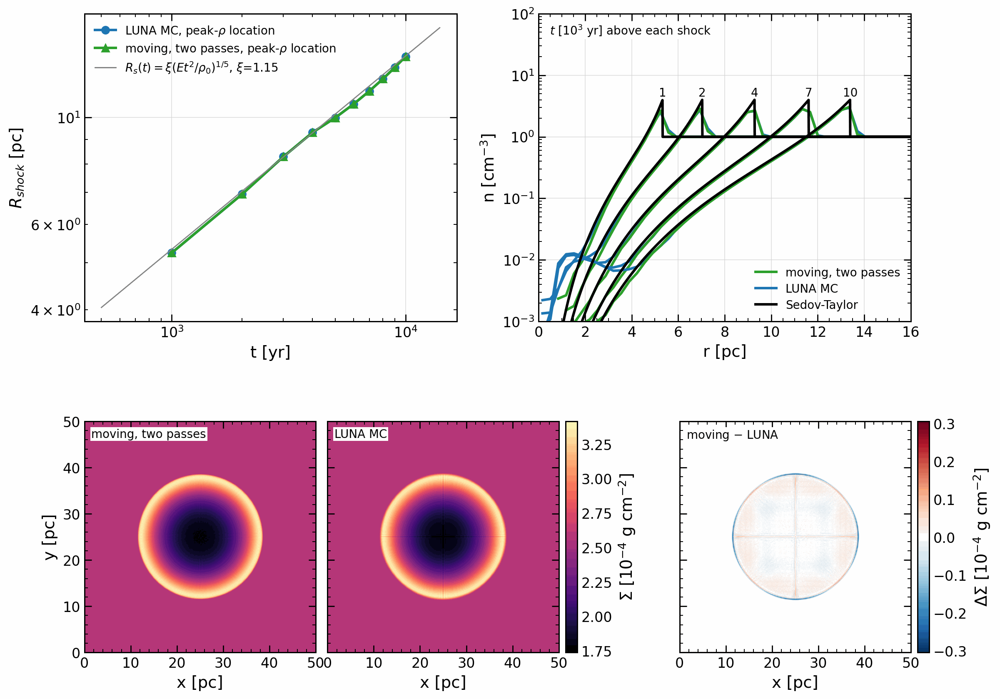
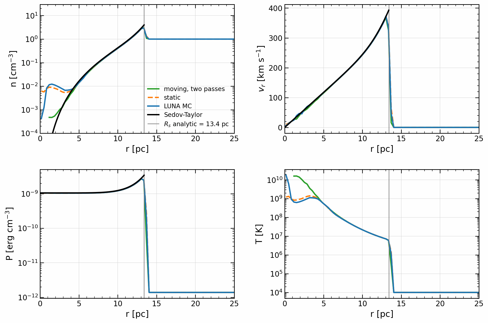
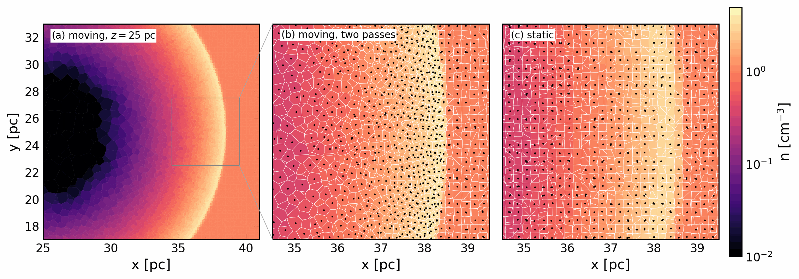
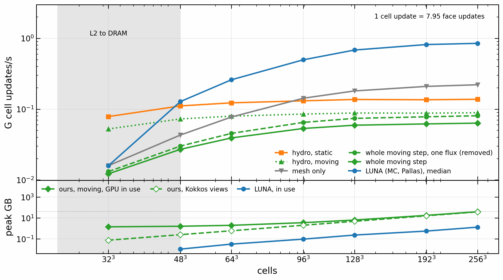
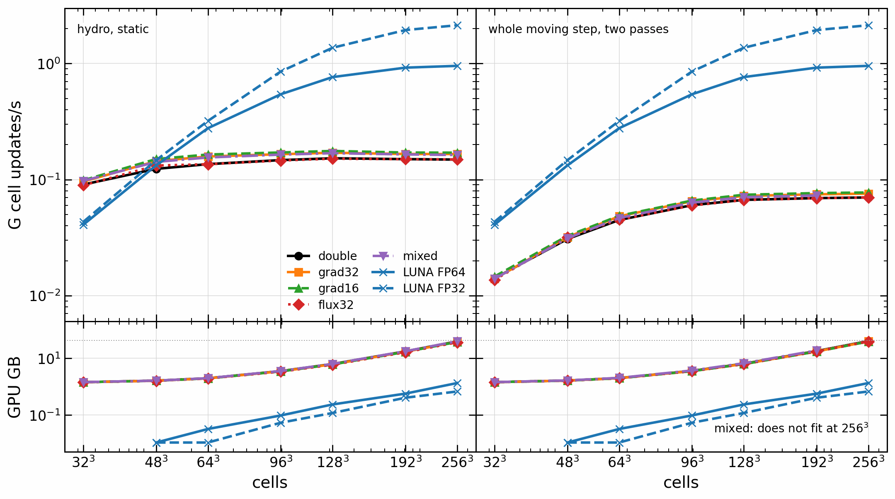
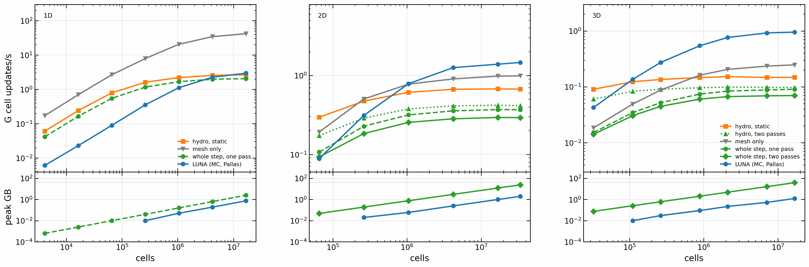

# luna-cpp

Moving-mesh hydrodynamics on GPUs. The fluid is solved on exact Voronoi meshes from [voronoi-cpp](https://github.com/Ulli1991/voronoi-cpp) (a git submodule), and the mesh can move with the flow so that cells follow the gas. Written in Kokkos C++: CUDA (validated on an A100 40 GB), plus OpenMP and Serial builds that run the same code for checks. Results are measured against LUNA, a static-grid GPU code, on the same test problems.

The scheme is MUSCL-Hancock with HLLC or HLL on static meshes, and AREPO next generation's two flux passes on moving ones, with least-squares gradients and mesh regularisation in the style of AREPO. It runs in 3D and 2D (periodic boxes) and 1D (with walls), and is bit-reproducible from run to run. On Sedov 3D at 256³ the moving mesh takes 925 steps where the static mesh takes 5834.

BSD 3-Clause, see [LICENSE](LICENSE).

## Install and build

```sh
git clone --recursive https://github.com/Ulli1991/luna-cpp.git
```

In an existing clone, run `git submodule update --init --recursive`. A build stops if `extern/voronoi-cpp` is behind voronoi-cpp `main`: update the pin and commit it. `-DLUNA_ALLOW_OLD_PIN=ON` only warns, to reproduce an old result.

Dependencies:

- CMake 3.16 or later and a C++17 compiler (gcc 14/15 tested).
- Kokkos 5.0 (5.0.2 in CI, 5.0.99 on Raven) with CUDA, OpenMP or Serial. CUDA uses `Kokkos_ARCH_AMPERE80` on an A100, Kokkos' `nvcc_wrapper`, and CUDA 13.0.
- HDF5 (C) for `hydro_sedov`; without it the other targets still build.

CUDA (A100), on Raven:

```sh
module load gcc/14 cuda/13.0 cmake hdf5-serial
cmake -S . -B build-cuda -DCMAKE_BUILD_TYPE=Release \
  -DCMAKE_PREFIX_PATH=/u/uli/kokkos-cuda \
  -DCMAKE_CXX_COMPILER=/u/uli/kokkos-src/bin/nvcc_wrapper -DCMAKE_CXX_EXTENSIONS=OFF
cmake --build build-cuda -j4
```

OpenMP (CPU), on Raven:

```sh
module load gcc/15 cmake hdf5-serial/1.12.2
cmake -S . -B build-omp -DCMAKE_BUILD_TYPE=Release \
  -DCMAKE_PREFIX_PATH=/u/uli/kokkos-gcc15 -DCMAKE_CXX_FLAGS=-march=icelake-server
cmake --build build-omp -j4
```

Elsewhere, point `CMAKE_PREFIX_PATH` at a Kokkos installation with the backend you want. On Raven, build with at most `-j4` on the login node, or inside a Slurm job, and run GPU work through Slurm.

`cmake --build` with no target gives `hydro_sedov`, `hydro_1d`, `hydro_wave3d` and the tests. The pinned voronoi-cpp still holds its own copy of the hydro, so the CMake targets here are `luna_hydro_library`, `luna_hydro_sedov` and `luna_hydro_1d`. To build one program use those names: `--target hydro_1d` would build the submodule's copy.

### Compiler flags in use

- Release: `-O3 -DNDEBUG` (CMake's default), C++17 required (Kokkos sets `-std=c++20`), warnings `-Wall -Wextra -Wpedantic` on the programs.
- CUDA: `nvcc_wrapper` with `-extended-lambda -arch=sm_80`. Kokkos forces `CMAKE_CXX_EXTENSIONS=OFF` for this install and warns unless it is given. Do not set it for the OpenMP build: there the code compiles with `-std=gnu++20`, and `-std=c++20` changes gcc's FP contraction, so the bits.
- OpenMP: `-fopenmp` from Kokkos. The project sets no `-march`; use `-DCMAKE_CXX_FLAGS=-march=icelake-server` on Raven's CPUs.
- `-DCMAKE_EXPORT_COMPILE_COMMANDS=ON` (always on in `CMakeLists.txt`) writes the database clang-tidy needs: `bash scripts/lint_cpp.sh build-omp` (Raven: `module load clang/20`).
- `-DVORONOI_SANITIZERS=ON` adds address and undefined-behaviour sanitizers to a host build.

## Tests

Run times are in [TESTING.md](TESTING.md). The mesh's own tests are in voronoi-cpp.

| Test | Specifies |
|---|---|
| `hydro` | HLLC and HLL fluxes, conservation, bit-identical runs, moving-mesh invariances (bulk velocity, Galilean blast) |
| `hydro_wave` | moving 3D step on smooth flow, both integrators: Yee's vortex and a sound wave against measured bounds |
| `hydro2d` | 2D hydro, static and moving: uniform states, conservation, sound-wave order, Sod, Noh, a Galilean blast |
| `hydro1d` | 1D hydro: conservation, inflow, cells from a wall with the budget through it, Sod against the exact solution; LUNA's final states of Sod, Shu-Osher and Woodward-Colella at N = 16 to 1e-12 |

```sh
ctest --test-dir build-cuda --output-on-failure
OMP_NUM_THREADS=1 ctest --test-dir build-omp
```

CI (`.github/workflows/checks.yml`) runs clang-tidy and the CPU tests in ordinary and sanitizer builds against a pinned Serial Kokkos 5.0.2, with the submodule checked out. It does not run GPU jobs.

## The hydro

`hydro::FiniteVolume` (`src/hydro/`) runs finite volumes on a static or moving `voronoi::Mesh`. On a moving mesh the points follow the flow with a drift towards the cell centroids, the mesh is repaired every step, and fluxes go through the moving faces. Each step uses least-squares gradients of the primitives, a MUSCL-Hancock half step, and HLLC (default) or HLL along each face normal, with one global time step (Courant factor 0.3). Order 0 is first-order Godunov. Every cell sums over its face list in a fixed order, which makes runs bit-reproducible. There are two update loops: per face (default at second order) and per cell (default at first order).

On a moving mesh the default integrator is AREPO next generation's two passes: fluxes on the mesh at the start of the step, half applied, the mesh update, then fluxes on the new mesh, half applied. `--integrator=one-pass` selects the MUSCL-Hancock step of the static mesh instead. Moving-mesh numbers below name the integrator used.

In 3D the default precision, moving and static, is `grad32`: gradients, limiter and face-state change in float, everything else double. `--precision=double` selects double throughout, with the bits of the old default, for reproducing old results; logs of those runs call it `default`. 2D and 1D stay double: `grad32` has not been measured in 2D, and 1D has no precision options. Results older than this change, including the 2D, 1D and accuracy figures below, are double.

```text
hydro_sedov <side> <jittered|uniform> [--order=0|1] [--update=cell|face] [--limiter=face|cell|none]
            [--riemann=hllc|hll] [--precision=default|double|grad32|mixed|low|...] [--moving] [--bulk=km/s] [--out=dir] [--snapshots=10] [--gradients] [--steps=max] [--input-order] [--memory]
            [--integrator=one-pass|two-pass] [--cold=f] [--watch]
hydro_wave3d <sound|simple|vortex|tube> <nx> [--moving] [--integrator=one-pass|two-pass] [--jitter=spacings] [--precision=default|double|grad32|grad16] [--out=file.npy]
sbatch -o <logs>/hydro-%j.out scripts/hydro_a100.sh build-cuda <out> <mode> (see the script)
```

`hydro_sedov` (needs HDF5; on Raven `module load hdf5-serial`) runs a Sedov blast (1e51 erg, n = 1 cm⁻³, 50 pc box, 1e4 yr) and writes HDF5 snapshots. Speed on one A100 at 1305 MHz, 40 steps, jittered points, LUNA in the same job; jobs and details are in [docs/measurements.md](docs/measurements.md).

| G cell updates per second | 2,097,152 cells | 16,777,216 cells |
|---|---|---|
| moving mesh, two passes (default), `grad32` (default), HLLC, per-face loop (mesh update included) | 0.072 | 0.076 |
| moving mesh, one pass, same | 0.091 | 0.099 |
| static mesh, MUSCL-Hancock HLLC, `grad32`, per-face loop | 0.170 | 0.166 |
| static mesh, MUSCL-Hancock HLL, `grad32`, per-face loop | 0.177 | |
| static mesh, first order HLLC, per-cell loop | 0.312 | |
| `--precision=double`: moving, two passes | 0.067 | 0.070 |
| `--precision=double`: moving, one pass | 0.084 | 0.091 |
| `--precision=double`: static, HLLC | 0.152 | 0.148 |
| LUNA, MC, HLLC, Pallas, FP64 | 0.47 | 0.87 |
| LUNA, same, FP32 | 0.68 | 1.74 |
| device memory, static (per-face, second order), `grad32` | 2185 B/cell | 2185 B/cell |
| device memory, moving, two passes (per-face), `grad32` | 2255 B/cell | 2255 B/cell |
| device memory, moving, one pass (per-face), `grad32` | 2233 B/cell | 2233 B/cell |
| device memory, `--precision=double`: static; two passes; one pass | 2250; 2319; 2298 B/cell | 2250; 2319; 2298 B/cell |
| device memory, LUNA, FP64 | 0.22 GB | 1.25 GB, 0.63 GB in FP32 |

LUNA has the higher cell update rate in every row, and its 128³ rate moved between jobs (FP64 0.47 to 0.76). At 256³ the moving mesh takes 925 steps against LUNA's 4035, about 4.4 times fewer, but its whole step is 12 times slower.

Accuracy on Sedov at 128³ (HLLC): shock radius 0.978 of the Sedov-Taylor value at 1e4 yr, L1 density error 0.075 rho0 (first order: 0.104), mass and energy conserved to 2e-16. The moving mesh needs 354 steps instead of 1642 for an L1 of 0.058 rho0. These L1 values are sampled at the mesh generators, which flatters a moving mesh. The field L1 is the fair norm: for density within r < 1.5 R_s it is 0.0629 (one pass) and 0.0648 (two passes) at 128³, and 0.0369 and 0.0377 at 256³.

### 2D (`hydro_kh2d`, `hydro::FiniteVolume<2>`)



Kelvin-Helmholtz of McNally, Lyra & Passy (2012) at t = 0, 1, 2.5, 4, 5, moving (two passes) against LUNA, both at N = 2048. Past t = 2.5 secondary instabilities on the moving billows set in earlier than in LUNA; this is not a converged solution in either code.



The moving mesh at t = 4 (N = 512), the whole box and three nested zooms into a billow. The map is the scheme's own field with the exact Voronoi edges drawn over it.



Density at t = 1.0, 1.5, 2.5, 3.0 for LUNA, static and moving (N = 2048), with the differences from LUNA. Static stays close to LUNA throughout (mean |Δρ| 4e-8 at t = 1.0 to 6e-4 at t = 3.0). The moving billows no longer match past t = 1.5 (mean |Δρ| 5e-5 at t = 1.0, 0.012 at t = 2.5, 0.073 at t = 3.0).

`hydro_kh2d <N> [--moving] [--integrator=one-pass|two-pass] [--bulk=<u>] [--out-times=t,...] [--stop-after=<s>] [--resume] ...` runs this test; the last two split a long run across jobs.

G cell updates/s at N = 2048: LUNA 1.78, static 0.756, moving one pass 0.414, two passes 0.322; peak 693, 735 and 749 B/cell for ours. GPU seconds to reach max |e| = 0.001: LUNA 0.55, static 1.1, moving 15. Details: research_notes/stage2_2d_2026-11-05.md.

### 1D (`hydro_1d`, `finite_volume_1d.hpp`)

`hydro::FiniteVolume<1, Exec, Riemann>` on `voronoi::Mesh<1>`, static or moving, with walls (reflective, zero gradient, inflow); a wall that gas enters supplies cells. The whole step is one kernel. A static run uses Courant x V / (|v| + c) at 0.8; a moving run uses AREPO next generation's rule at 0.4 (3D stays at 0.3). Moving points are regularised as in AREPO next generation.

G cell updates/s on one A100 at 1305 MHz, Sod, HLLC (hydro only is a static step, whole step a moving one at its defaults):

| cells | 4,096 | 65,536 | 1,048,576 | 16,777,216 |
|---|---|---|---|---|
| hydro only | 0.081 | 0.948 | 2.810 | 3.226 |
| whole moving step | 0.048 | 0.636 | 1.872 | 2.297 |

Below about 1e5 cells a step is bound by launch latency, not by the kernel. Peak device memory is 144 B/cell static and 152 B/cell moving.

## Figures

From `scripts/make_figures.py`, in LUNA's figure style. Setups and jobs are in [docs/measurements.md](docs/measurements.md).


Sod shock tube, N = 512, against the exact solution. Moving has the sharper contact, and 2.5 times LUNA's error at the tail of the rarefaction (x = 0.48). Static lies on LUNA.


Shu-Osher, N = 1024 on LUNA's domain. Moving holds the left wall at the fixed inflow state instead of LUNA's zero flux, which static keeps, because a zero-flux wall let the totals drift from the budget through the walls. Gas enters there, and the wall supplies cells at the initial spacing, 1508 at the end ([research_notes/inflow_2026-11-06.md](research_notes/inflow_2026-11-06.md)).


Woodward-Colella, N = 2048. Moving holds the contacts and shocks in far fewer cells than LUNA, with an overshoot at x = 0.765.


Error of the reconstructed field against resolution. On Sod, moving is ahead of LUNA in density and 2 to 13 % over it in pressure. On Shu-Osher moving is at or below LUNA in density, velocity and pressure at every N to 2¹⁷ (ratios 0.39-0.81, 0.79-0.84, 0.83-0.99), N being the cells at the start; density falls off order 1 above 2¹⁵. On Woodward-Colella moving is ahead of LUNA, with a stall near 3.4e-4 in density.


GPU time to reach a given error in 1D. LUNA wins Sod and Shu-Osher, there by 7-16x: moving takes 7.5x the steps and ends with 1.47x the cells. On Woodward-Colella it is close in density and pressure, and only moving reaches a density error of 1e-3 in the ladder.


Convergence of the 3D Yee vortex. Moving with one pass is first order; two passes (now the default) reach order 2.2, then 1.5, and stay above static.


Kelvin-Helmholtz after McNally, Lyra & Passy (2012): error of the growth measure against their reference curve, for N² cells. LUNA and static lead at equal N, and LUNA in GPU time. Moving with one pass stalls near 4e-4; two passes recover.


Sedov 3D is a shock test that cannot rank schemes: its order is below 1 for every code (0.66 LUNA minmod, 0.78 moving, n = 128 to 256). Left, density shells at 128³; right, field L1 against resolution. Moving is one pass and older than the two-pass default in these runs.



The same Sedov at 256³ against LUNA and Sedov-Taylor: shock radius, density profiles at five times, and column density with the difference. The difference reaches 9 % of the peak at the shock, mean 0.2 %. LUNA's published figure is at 1024³; all runs here are 256³, four times coarser, so the peak falls below Sedov-Taylor by resolution and the two are not to be read as equal.



Radial profiles at 1e4 yr against Sedov-Taylor. The moving mesh follows Sedov-Taylor down to n of 10⁻³, where the fixed grids hold a floor near 10⁻². Moving curves start at 1.2 pc, inside which the shells hold no generator.



A slice through the 3D mesh at 1e4 yr: (a) moving, where cells gather in the shell and open behind it; zooms into the same window, (b) moving, (c) static.



Throughput and memory against resolution, 32³ to 256³, on Sedov 3D, with LUNA. Hydro is flat from 96³ to 256³; below 64³ the fixed cost per step dominates.



The same sweep for our precision options, against double. The default, `grad32`, gains 12 % on hydro static and 8 % on the whole two-pass step. At 128³ the fastest option, `grad16`, gains 15 % on hydro and 10 % on the whole step. None of our options is FP32 throughout, so LUNA FP32 is not like for like. At 256³:

| 256³ | double | `grad32` | `grad16` | LUNA FP64 | LUNA FP32 |
|---|---|---|---|---|---|
| hydro static, G cell updates/s | 0.149 | 0.166 | 0.170 | 0.954 | 2.133 |
| whole two-pass step, G cell updates/s | 0.070 | 0.076 | 0.077 | | |
| GPU GB, two passes | 40.5 | 39.4 | 38.9 | 1.25 | 0.63 |

`grad32` against double on one A100:

| Test | moving, two passes | static |
|---|---|---|
| vortex, nx = 64 to 256, change of L1 against the exact averages | at most 3e-4 rho, 1e-3 P; v unchanged in 4 digits | unchanged in 4 digits |
| sound, simple wave, tube | unchanged in 4 digits | unchanged in 4 digits |
| Sedov field L1, 128³ and 256³ | unchanged in 4 digits | unchanged in 4 digits |
| cells by id against the double run, L1 | up to 4e-6 in rho (vortex, 256) | below 2e-9 |

Float gradients add no error floor down to the smallest L1 measured, 1e-6. Moving runs differ cell by cell because one rounding change moves the mesh; their errors against the exact solution do not change. `grad32` costs one known thing: Galilean invariance of the radial profile goes from 6e-14 to about 2e-10. `hydro_wave` holds `grad32` to double on vortex and sound, moving and static.



Throughput against resolution in 1D, 2D and 3D, with LUNA, on a blast problem in each. At the largest size static hydro runs 2.66, 0.67 and 0.15 G cell updates/s, LUNA 2.96, 1.46 and 0.95: level in 1D, 2.2 times ahead in 2D, 6.4 times in 3D, in line with the faces per cell but not separated from other causes. Our 1D leads LUNA up to 4M cells. Two passes take the whole step to 0.29 in 2D and 0.07 in 3D.

## Limitations and open items

- The hydro step is not yet at its target (0.3 G cell updates/s static, 0.15 G the whole two-pass step). At 128³ `grad32` runs at 0.170 static, and the whole moving step at 0.091 with one pass and 0.072 with two (double: 0.152, 0.084, 0.067). The step is memory-latency bound: the hydro kernels spend 61 to 98 % of their warp slots waiting for memory, and the gradient sweep is the slowest. Roofline numbers are in the measurements file. Compile-time `--precision=` options give up to +19 % (`low`) on static hydro against double.
- Moving 256³ on a 40 GB A100: two passes fit, in `grad32` (2255 B/cell) and in double (2319 B/cell); with `--precision=mixed` they do not (2445 B/cell). Use `--integrator=one-pass` there, or the default.
- On the CPU (gcc's default FP contraction) some hydro modes differ from the GPU in the last bits; the A100 runs are bit-identical run to run.
- Periodic boxes only in 3D and 2D; only 1D has walls.
- 1D moving mesh: a wall supplies cells where gas enters, but nothing removes points where gas leaves: no test has points reach an open wall, and that path is not tested. A subsonic inflow keeps LUNA's zero-gradient wall, whose state drifts by about 1e-7 at N = 2¹⁷ (research_notes/inflow_2026-11-06.md).
- 1D moving mesh: the error of Woodward-Colella stops falling near N = 2¹⁵, at every Courant number tried (research_notes/stage1_1d_2026-11-04.md).

## Roadmap

Done: 3D, 2D and 1D hydro on the exact mesh, two passes as the default on moving meshes, a first round of hydro speed (0.107 to 0.152 G cell updates/s static), `grad32` as the 3D default (0.170).

1. Hydro speed: target 0.3 G cell updates/s static, 0.15 G the whole two-pass step. Next: an owner bit in the list entries (estimate +8 % static, +5 % whole step), faces numbered by owner in the mesh (+8 % hydro measured with a copy, +5 % whole step estimated). Sorting cells by list length and reusing the half step between passes were measured and made it slower.
2. A standing 3D test suite with LUNA coverage ([#7](https://github.com/Ulli1991/luna-cpp/issues/7)), including a test that doesn't favour lattices.
3. Time integration study ([#1](https://github.com/Ulli1991/luna-cpp/issues/1)), accuracy scorecard.
4. Local time stepping from AREPO-ng ([#9](https://github.com/Ulli1991/luna-cpp/issues/9)), a CPU path for few active cells ([#10](https://github.com/Ulli1991/luna-cpp/issues/10)).
5. Multi-GPU.
6. Refinement.
7. Multigrid self-gravity.
8. Autodiff in C++ with Enzyme ([#12](https://github.com/Ulli1991/luna-cpp/issues/12)).

Open bugs: a forced rebuild beside two passes runs out of memory at 256³ ([#11](https://github.com/Ulli1991/luna-cpp/issues/11)); stuck flips at 256³ ([#8](https://github.com/Ulli1991/luna-cpp/issues/8)); NaN from zero-area faces on an exact lattice ([#6](https://github.com/Ulli1991/luna-cpp/issues/6)). Mesh bugs that reach the hydro are listed in the [voronoi-cpp README](https://github.com/Ulli1991/voronoi-cpp#limitations-and-open-items).

## Repository layout

- `src/hydro/`: the hydro (header-only). `src/bench/`: `hydro_sedov`, `hydro_1d`, `hydro_wave3d`, `hydro_kh2d`. `src/test/`: the tests.
- `extern/voronoi-cpp/`: the mesh library, pinned submodule.
- `scripts/`: A100 run scripts, comparison and figure scripts (`make_figures.py`, `figstyle.py`), `lint_cpp.sh`.
- `docs/figures/`: the figures.
- `research_notes/`, `reports/`: status notes.
