# luna-cpp

Moving-mesh hydrodynamics on GPUs. luna-cpp solves the Euler equations with finite volumes on the exact Voronoi meshes of [voronoi-cpp](https://github.com/Ulli1991/voronoi-cpp), included as a git submodule. The mesh can stay fixed, or move with the gas so that cells follow the flow. It is written in Kokkos C++ and runs on CUDA (tested on an A100 40 GB), with OpenMP and Serial builds of the same code for checks. Every result is measured against LUNA, a static-grid GPU code, as the yardstick.

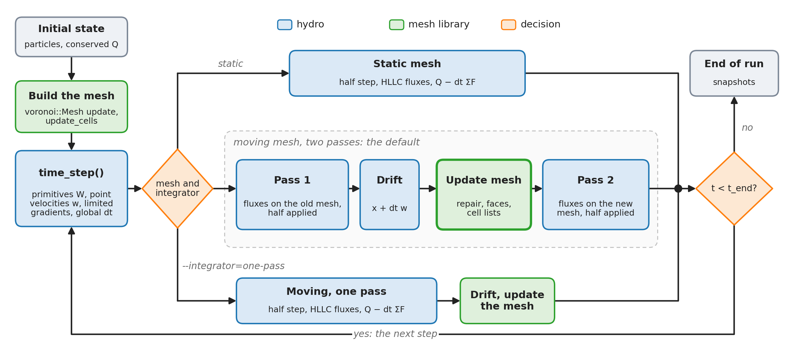

One run from start to finish. Each step takes a time step, then advances the gas on a static mesh, or on a moving one with fluxes on the old and the new mesh. The green boxes are calls into voronoi-cpp.

BSD 3-Clause, see [LICENSE](LICENSE).

## Where it stands

- **Accuracy:** on shocks and contacts the moving mesh often beats LUNA at the same resolution, because cells follow the gas: sharper contacts on Sod, a smaller error on Shu-Osher and Woodward-Colella, and Sedov's low-density centre resolved down to 10⁻³ where fixed grids stop near 10⁻². On smooth flow the static mesh matches LUNA, and the moving mesh is second order in 3D, 2D and 1D.
- **Speed:** in 2D and 3D LUNA is faster per cell update, by 2 to 6 times on the static hydro and more on the moving step (in 3D 1.6 times per face, static); in 1D the two are level, and ours is faster below 4M cells. The moving mesh needs fewer steps (925 against LUNA's 4035 on Sedov at 256³), but not enough fewer to win on GPU time yet.
- **Scale:** 256³ cells fit on one 40 GB A100, moving or static.

## Install and build

```sh
git clone --recursive https://github.com/Ulli1991/luna-cpp.git
```

In an existing clone, run `git submodule update --init --recursive`. `extern/voronoi-cpp` holds the library's full source at a pinned commit, so it can be edited and committed from here. A build warns if the pin is behind voronoi-cpp `main`; the pin moves when luna-cpp needs a newer library (`git submodule update --remote extern/voronoi-cpp`, then commit). `-DLUNA_STRICT_PIN=ON` makes that warning stop the build. The pin is voronoi-cpp 1741a1a (main of 2026-11-18, its step-2x levers), moved from abd3d39: the mesh update is 9 to 10 % faster and the moving step 3.6 to 3.8 %, at 66 B/cell more. 1D, 2D and static 3D runs keep their bits; moving 3D runs differ in Q at rounding level with the same field errors ([TESTING.md](TESTING.md#moving-the-pin)).

Dependencies:

- CMake 3.16 or later and a C++17 compiler (gcc 14/15 tested).
- Kokkos 5.0 (5.0.2 in CI, 5.0.99 on Raven) with CUDA, OpenMP or Serial. CUDA uses `Kokkos_ARCH_AMPERE80` on an A100, Kokkos' `nvcc_wrapper`, and CUDA 13.0.
- HDF5 (C) for `hydro_sedov`; without it the other targets still build.

CUDA (A100), on Raven:

```sh
module load gcc/14 cuda/13.0 cmake hdf5-serial
cmake -S . -B build-cuda -DCMAKE_BUILD_TYPE=Release \
  -DCMAKE_PREFIX_PATH=/u/uli/kokkos-cuda \
  -DCMAKE_CXX_COMPILER=/u/uli/kokkos-src/bin/nvcc_wrapper -DCMAKE_CXX_EXTENSIONS=OFF
cmake --build build-cuda -j4
```

OpenMP (CPU), on Raven:

```sh
module load gcc/15 cmake hdf5-serial/1.12.2
cmake -S . -B build-omp -DCMAKE_BUILD_TYPE=Release \
  -DCMAKE_PREFIX_PATH=/u/uli/kokkos-gcc15 -DCMAKE_CXX_FLAGS=-march=icelake-server
cmake --build build-omp -j4
```

Elsewhere, point `CMAKE_PREFIX_PATH` at a Kokkos installation with the backend you want. On Raven, build with at most `-j4` on the login node, or inside a Slurm job, and run GPU work through Slurm.

`cmake --build` with no target gives `hydro_sedov`, `hydro_1d`, `hydro_kh2d`, `hydro_wave3d` and the tests. voronoi-cpp (the submodule) is the mesh library only, so the solver lives here. The CMake targets keep the `luna_` prefix from the split: `luna_hydro_library`, `luna_hydro_sedov`, `luna_hydro_1d`, `luna_hydro_kh2d`, `luna_hydro_wave3d`; build one with `--target luna_hydro_1d`.

### Compiler flags in use

- Release: `-O3 -DNDEBUG` (CMake's default), C++17 required (Kokkos sets `-std=c++20`), warnings `-Wall -Wextra -Wpedantic` on the programs.
- CUDA: `nvcc_wrapper` with `-extended-lambda -arch=sm_80`. Kokkos forces `CMAKE_CXX_EXTENSIONS=OFF` for this install and warns unless it is given. Do not set it for the OpenMP build: there the code compiles with `-std=gnu++20`, and `-std=c++20` changes gcc's FP contraction, so the bits.
- OpenMP: `-fopenmp` from Kokkos. The project sets no `-march`; use `-DCMAKE_CXX_FLAGS=-march=icelake-server` on Raven's CPUs.
- `-DCMAKE_EXPORT_COMPILE_COMMANDS=ON` (always on in `CMakeLists.txt`) writes the database clang-tidy needs: `bash scripts/lint_cpp.sh build-omp` (Raven: `module load clang/20`).
- `-DVORONOI_SANITIZERS=ON` adds address and undefined-behaviour sanitizers to a host build.
- `-DLUNA_DERIVATIVE_TESTS=ON` adds `hydro_derivatives_test` (off by default while the derivatives are new).
- `-DLUNA_BIT_EXACT=ON` turns off FMA contraction (`-fmad=false` on the device, `-ffp-contract=off` on the host). The fixed grid then gives LUNA's bits, and `grid_test` checks them bit for bit. Off by default, because contraction is faster; the grid then agrees with LUNA to rounding.


## Running

```text
hydro_sedov <side> <jittered|uniform> [--moving] [--order=0|1] [--riemann=hllc|hll] [--limiter=face|none]
            [--precision=default|double|grad32|grad16|single|mixed|low] [--bulk=km/s]
            [--out=dir] [--snapshots=10] [--steps=max] [--memory] [--update=face|cell] [--phases] [--keep-mesh]
            [--curve=hilbert|morton|moore|gray|row|rcm] [--every=k] [--plain-faces] ...
hydro_kh2d <N> [--moving] [--out-times=t,...] [--stop-after=<s>] [--resume] ...
hydro_1d <problem> <N> [--moving] [--limiter=face|none|minmod|vanleer] [--dt=luna|arepo|fixed] [--courant=c] ...
hydro_wave3d <sound|simple|vortex|tube> <nx> [--moving] [--precision=...]
hydro_sedov <side> grid --grid [--kernel=cuda|kokkos] [--limiter=minmod|mc|vanleer] [--riemann=hllc|hll] [--cfl=0.8]
            [--tile=x,y,z] [--steps=max] [--out=file.npy]
sbatch -o <logs>/hydro-%j.out scripts/hydro_a100.sh build-cuda <out> <mode>
```

`hydro_sedov` needs HDF5 and writes snapshots. Every program prints a banner on stderr at start if the configure step found the pinned voronoi-cpp behind voronoi-cpp `main`.

## The method

- **Finite volumes on a Voronoi mesh.** `hydro::FiniteVolume<D>` (`src/hydro/finite_volume.hpp`) handles 3D and 2D from one template; 1D has its own fused kernel (`finite_volume_1d.hpp`).
- **MUSCL-Hancock.** Least-squares gradients of the primitive variables, limited at the face centroids as in AREPO, a half step in time, then HLLC (default) or HLL along each face normal, with one global time step (AREPO next generation's face and cell terms, taken in one reduction).
- **Moving mesh.** Points follow the gas, with a small drift towards their cell centroids that keeps cells round. The mesh is repaired every step, and fluxes go through the moving faces. MUSCL-Hancock on a moving mesh takes the fluxes on the old mesh, half applied, moves the mesh, then takes them on the new mesh, half applied; that is the only moving step, in 1D, 2D and 3D. A single flux at the half step, an option until November 2026, is first order on a moving mesh and is gone. Points move by whole steps of the grid the mesh quantises them to, and the face velocities come from those moves, so rounding no longer makes a cell's volume change differ from what its faces swept ([#23](https://github.com/Ulli1991/luna-cpp/issues/23)).
- **Timing.** `hydro_sedov --phases` fences and times each phase of a step (the `phases_ms_median` and `throughput_M_per_s` lines); by default a step runs with no fences inside it and is timed whole (`step_wall_ms_median` and `G_cell_updates_per_s` in the `run` line; `gpu_s` sums those).
- **Precision.** 3D runs `grad16` by default: gradients and limiting in float with the gradient rows stored as FP16, everything else in double, except what the hydro only reads as offsets or step terms: on a moving mesh the face centroids are stored as float relative to the owner, and each point's move as int32 grid steps. Against `grad32` the moving step is 5.6 % (128³) and 5.8 % (256³) faster, with the field errors unchanged to three or four digits and a sound wave of amplitude 1e-6 kept (docs/measurements.md, "Precision levers of 2026-11-19"). 2D runs `grad32` (float gradients; the same errors as double on KH 2D and 6 to 12 % faster; an FP16 row of 8 values would pad to the same 32 B as a float row, so FP16 saves no bytes there and measured 0.4 to 0.6 % slower). 1D runs in double: its solver computes the gradients in registers inside one fused kernel and stores none, so there is nothing for a narrower type to save.
- **Bit-reproducible.** Every cell sums its faces in a fixed order, so an A100 run gives the same bits every time.
- **Fixed grid (`hydro_sedov --grid`, in development).** LUNA's own fixed-grid step inside luna-cpp, with no mesh: `hydro::grid::GridFiniteVolume<D>` (`src/hydro/grid_finite_volume.hpp`). The numerics follow LUNA operation for operation (`grid.hpp`):
  - MUSCL-Hancock with LUNA's limiters (minmod, MC, van Leer);
  - per-axis HLLC and HLL cores (`HLLC::axis_core`, `HLL::axis_core` in `euler.hpp`);
  - LUNA's face rule and floors;
  - boundaries periodic, zero-gradient, reflective and diode, with two ghost cells;
  - LUNA's CFL time step.

  A predictor kernel and a faces kernel run the step; the faces kernel also leaves the next time step. `--split=0` runs the whole step in one kernel. Both come as a hand-written CUDA kernel (`grid_cuda.hpp`) and as a Kokkos kernel with the same numbering; the Kokkos kernel also runs on the CPU. Without FMA contraction (`-DLUNA_BIT_EXACT=ON`) a step gives LUNA's bits. The design and plan are in `research_notes/fixed_grid_2026-11-19.md`.

  **Speed so far** (Sedov 3D, FP64, minmod, the same node and job): the CUDA kernels reach 0.85–0.89 G cell updates/s at 128³–384³ (0.81–0.84 with MC), and the Kokkos kernels 0.55–0.59. LUNA reaches 0.97–1.15 G. The step is split as LUNA's: a predictor kernel stores each cell's half-step state, then a faces kernel computes the fluxes and the update. The faces kernel needs 156 registers, which leaves 8 warps per SM, and its FP64 pipe is 26 % busy against 78 % in LUNA's faces kernel. Every lever is in `docs/tried.md`.
- **Stuck mesh steps.** When the mesh's device repair leaves stuck entries, voronoi-cpp's default `Fallback::cheapest` clips the cells around them again on the device and stitches them in (local repair) up to n / 64 stuck entries, and rebuilds the mesh past that or when the local repair does not finish. Before abd3d39 a few stuck entries went to a host finish and more to a rebuild. `hydro_sedov` prints `stuck_steps`, `local_repairs`, `local_cells` and `rebuilds` in its `mesh_updates` line. Moving Sedov to 1e4 yr, two runs per pin: nothing stuck at 128³; at 256³ (919 steps) one run on abd3d39 had one step with 6 stuck entries, repaired locally (49 cells, no rebuild), and ended with the same bits as the runs that did not stick. Which step sticks follows the order of the device flips' atomics, so it changes from run to run.
- **Static meshes keep only what a step reads.** After its set-up the hydro holds the mesh arrays a static step reads (face sides, face geometry, cell lists, cell volumes and centroids, positions) and scratch of its own (`FiniteVolume::release_mesh`), and `hydro_sedov` destroys the mesh with its tetrahedra, circumcentres, repair state, rings and face numbering: 1135 instead of 2366 B/cell during the steps, the same bits and speed; `--keep-mesh` keeps the whole mesh. The peak of the run is still the mesh build and set-up, 2172 B/cell (2106 before voronoi-cpp 1741a1a).
- **Mesh memory layout** (voronoi-cpp's `voronoi::Layout`, [#34](https://github.com/Ulli1991/voronoi-cpp/issues/34)). In 3D the cells' face lists carry the owner bit, so the hydro reads a face's side from the list; a static mesh also numbers its faces by owner (+135 B/cell). A moving mesh does not, because renumbering every step costs the mesh more than it saves the hydro ([#53](https://github.com/Ulli1991/voronoi-cpp/issues/53)). Same bits as without; `--plain-faces` turns both off. `--every=k` re-sorts the cells along `--curve` every k steps; the hydro carries its cell arrays across (`FiniteVolume::follow_resort`), and the run's bits change with the order. Re-sorting is off unless asked for (`FiniteVolume::no_resort`), although voronoi-cpp's own default is every 25 updates: in whole Sedov runs a re-sort makes the hydro 6 to 8 % faster but itself costs about one step, and at 256³ moving it runs out of memory (research note `moving_structure_2026-11-18.md`, branch `moving-structure`).

## Results in 1D

All 1D figures are density at the final time, at the resolution named, with zooms on the hard regions. Lines: moving mesh, static mesh, LUNA (MC limiter) and the exact or high-resolution reference.

### Sod shock tube

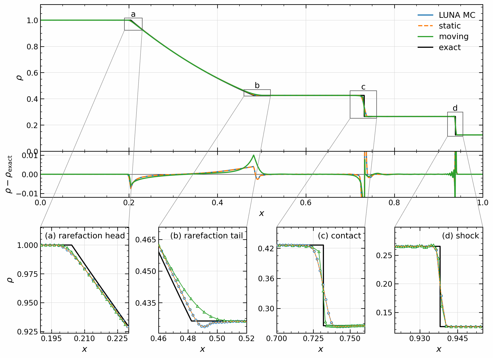

The standard Riemann problem: a rarefaction, a contact and a shock, N = 512. The moving mesh has the sharpest contact, and 2.5 times LUNA's error at the tail of the rarefaction (x = 0.48). Static lies on LUNA.

### Shu-Osher

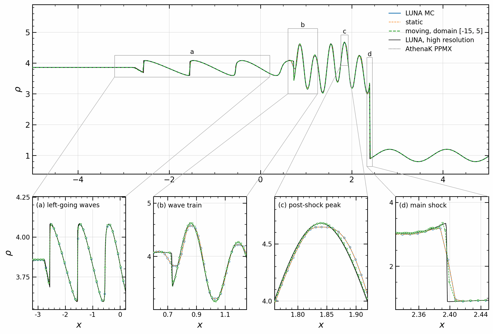

A Mach 3 shock running into a sine wave in density, which it compresses into short waves behind it, N = 1024 on LUNA's domain. Moving keeps the left wall at the fixed inflow state and adds cells there as gas enters, 1508 at the end; static and LUNA use a zero-flux wall. Moving resolves the short waves at least as well as LUNA.

### Woodward-Colella

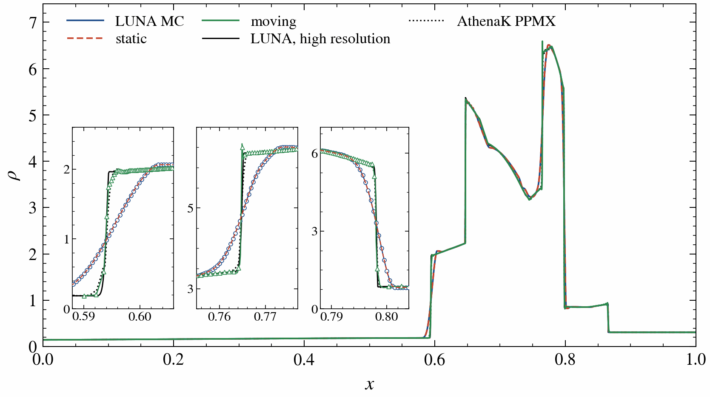

Two blast waves between reflecting walls that collide, N = 2048. Moving holds the contacts and shocks in far fewer cells than LUNA, with one overshoot at x = 0.765.

### Convergence

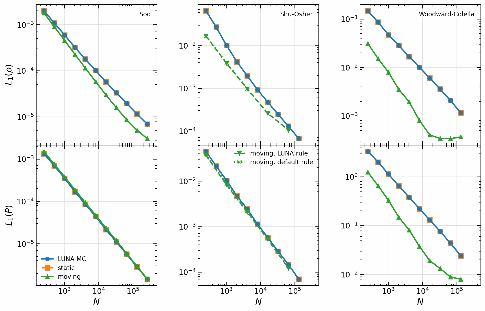

The error of the reconstructed field against resolution on the three tests. Moving is ahead of LUNA in density on Sod (2 to 13 % behind in pressure), at or below LUNA on Shu-Osher up to 2¹⁷ cells, and ahead on Woodward-Colella, where its density error stalls near 3.4e-4.

### Cost to reach an error

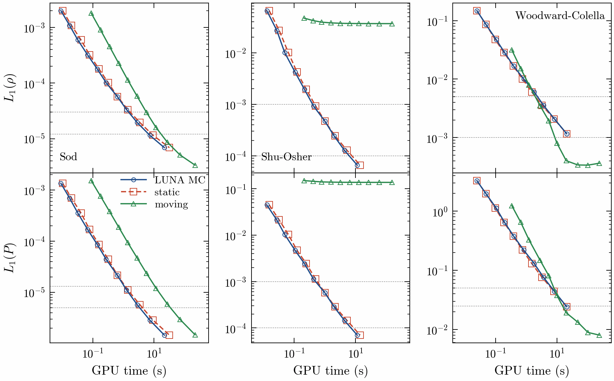

GPU seconds needed to reach a given error. LUNA wins Sod and Shu-Osher, by 7 to 16 times on Shu-Osher, where the moving mesh takes 7.5 times the steps and ends with 1.47 times the cells. Woodward-Colella is close, and only the moving mesh reaches a density error of 1e-3 in the ladder.

### Titarev-Toro

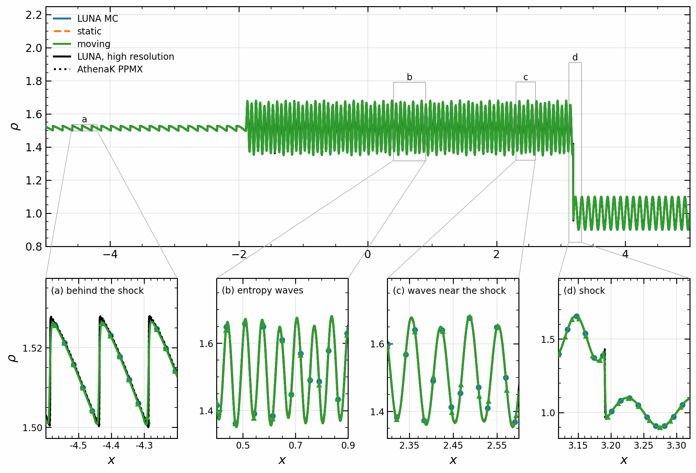

A shock running into a high-frequency entropy wave, whose short waves are hard to keep behind the shock. Moving, static and LUNA all follow the high-resolution LUNA and AthenaK references through the waves and at the shock.

### Toro test 5

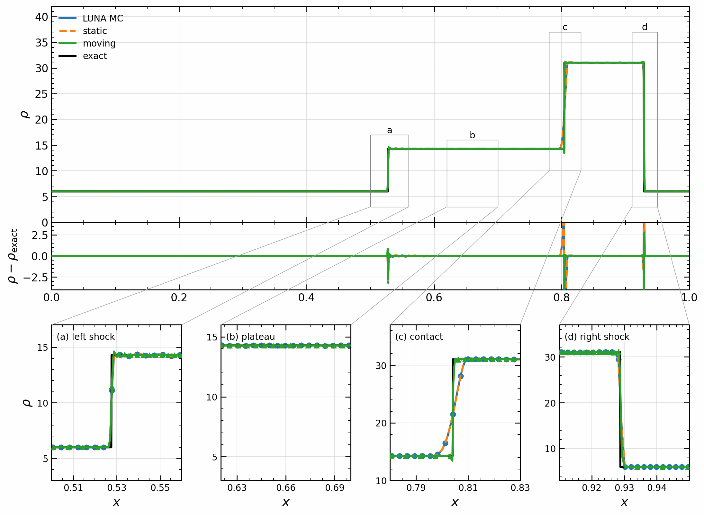

Two shocks with a strong contact between them that barely moves. The moving mesh holds the contact in about two cells, where LUNA and static smear it over about ten.

### Toro test 2: near vacuum

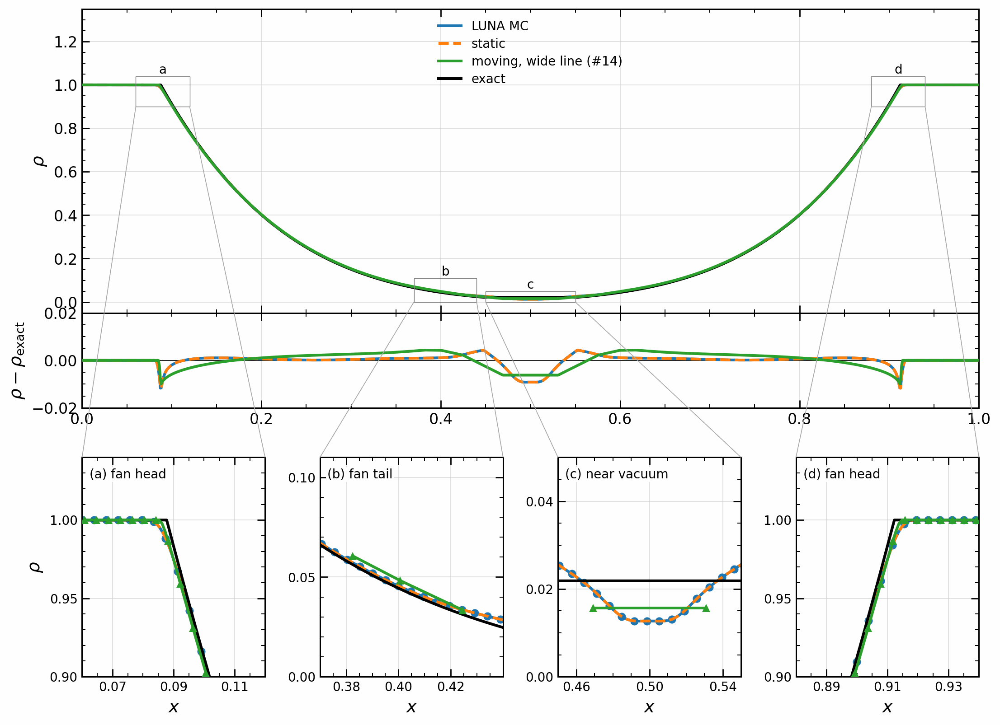

Two rarefactions running apart leave gas close to vacuum in the middle. All three follow the exact fans; the moving mesh, run on a wide line because its walls cannot yet let gas leave ([#14](https://github.com/Ulli1991/luna-cpp/issues/14)), has few cells left in the near-vacuum middle and misses its depth by a similar amount as the others.

### LeBlanc

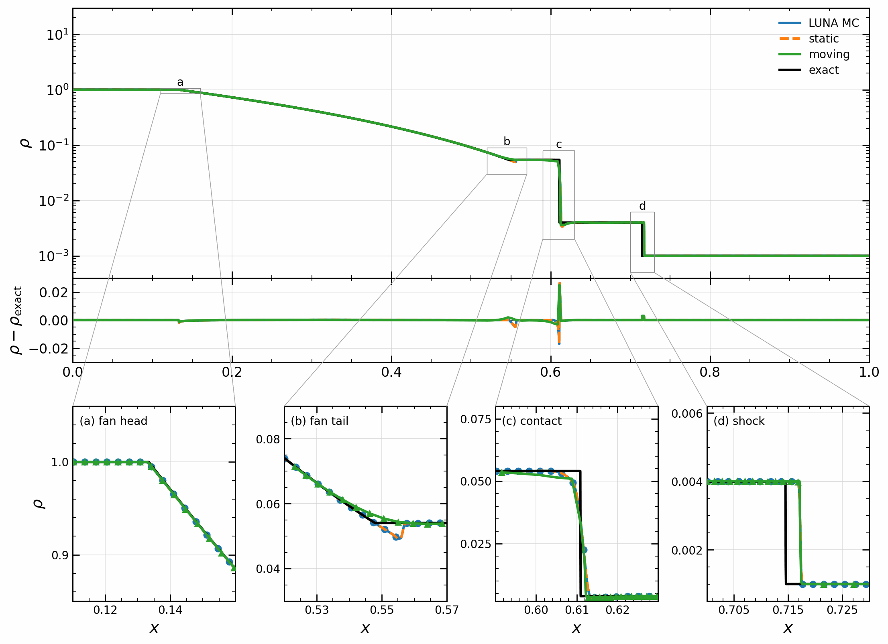

An extreme shock tube, with a pressure ratio of 10⁹ across the start. Moving, static and LUNA are close to each other everywhere, and all three put the final shock slightly ahead of the exact one, a known difficulty of this test.

### Noh

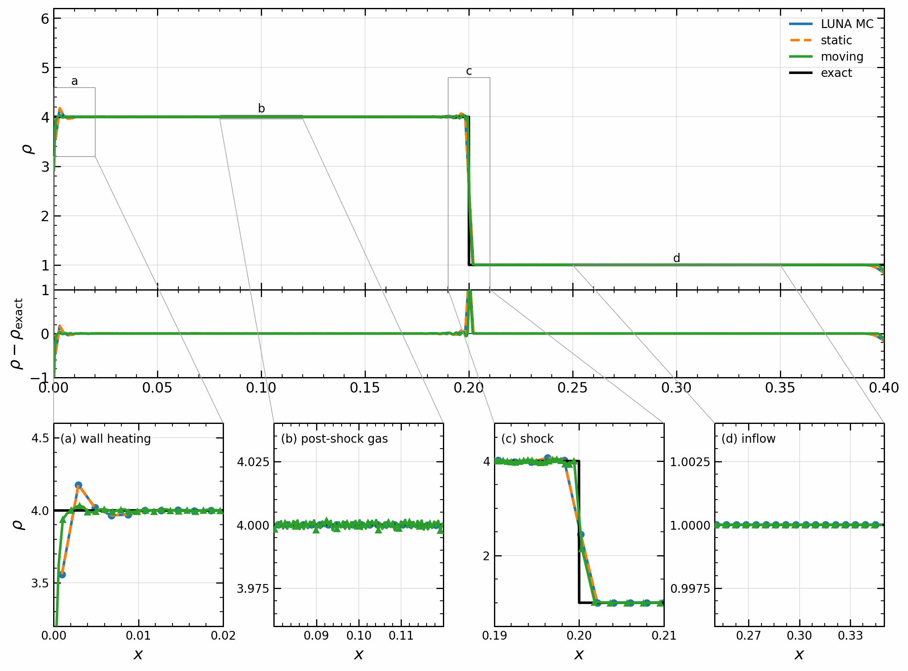

Gas streaming into a wall builds a shock that moves back out, with a well-known dip in density at the wall, N = 1024. The moving mesh avoids most of the dip. It runs at its default time step since the wall entered AREPO's rule as the end cell's mirror ([#27](https://github.com/Ulli1991/luna-cpp/issues/27)); before, cold gas into the wall allowed one step of the whole run. Behind the shock it keeps a cell-to-cell density pattern of about 3e-4 of the density at every N, which nothing in the cells' frame damps, so its error stops falling near 2.5e-4 (N = 32768 on): level with LUNA at 512, twice LUNA's at 4096, 20 times at 131072.

### Sound wave

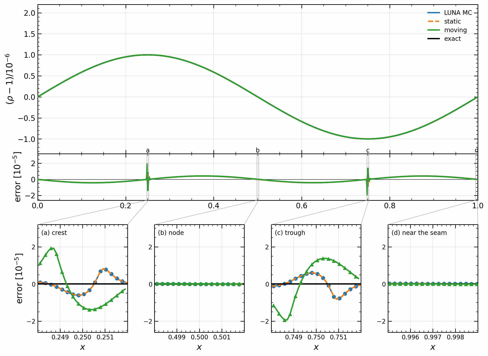

A small sound wave travelling once across a periodic line, the cleanest test of order on smooth flow. Static, LUNA and the moving mesh are second order. The moving mesh's error is smooth, about twice static's where the limiter clips the crest and the trough, and falls with N to 2e-8 of the amplitude at N = 65536; at 131072 it turns up to 1.4e-7, the rounding floor, as LUNA's does (6e-8; static 2e-8). Until November 2026 the moving error was noise from cell to cell that grew with N: the face velocities came from the point velocities while the volumes came from the rounded positions, and the two disagreed by rounding at every step ([#23](https://github.com/Ulli1991/luna-cpp/issues/23)). The faces now move exactly as the grid points do.

### Super-hard tube

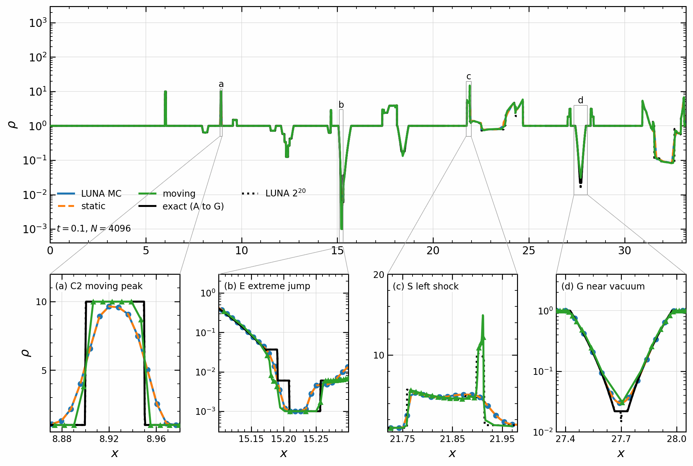

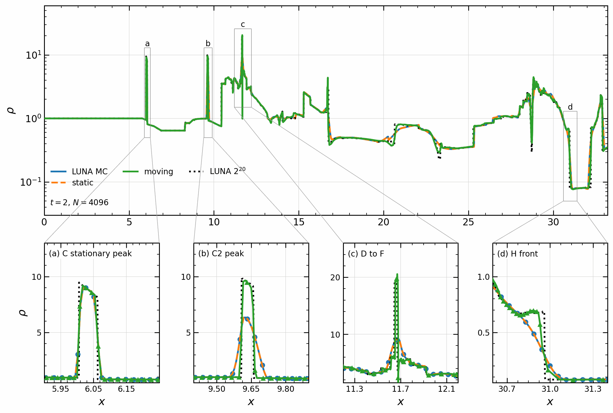

Our own test that puts the hard parts of the other 1D tests on one line: a quiet region, smooth waves, a standing and a moving density peak, a sonic-point rarefaction, a jump with a pressure ratio of 10⁹, a slow shock, colliding streams, a near-vacuum gap and a double blast against a reflecting wall, with an open wall on the left. At t = 0.1 the stages have not met yet and most have an exact solution; by t = 2 the blast's reflections have swept through all of them. Shown are LUNA, static and moving at N = 4096 against the exact solution and LUNA's own run at 2²⁰ cells. Our static mesh matches LUNA in every stage; the moving mesh is ahead in every stage at t = 0.1 except the smooth waves (2.7 % behind) and the sonic rarefaction (level), and holds the peaks and the front of the blast in far fewer cells at t = 2. The moving mesh reaches t = 2 since a point whose cell is lopsided, its generator beyond 0.75 r of the centroid, moves with the gas velocity at the generator ([#25](https://github.com/Ulli1991/luna-cpp/issues/25)): at N = 4096 its density error over all stages is 1.15 against static's 2.66. The setup is in research_notes/super_tube_2026-11-10.md, the problem is `super-tube` in `problems_1d.hpp`.

**Against AREPO and GIZMO.** The same tube in AREPO (master e6227faf, moving Voronoi mesh) and GIZMO (`gpu_kokkos_unified` 7fe8985, MFM and MFV), from the same cell averages, at t = 0.1. The plot shows the L1 error per stage against the exact solution (stages A to G) or LUNA at 2²⁰ cells (S, H).

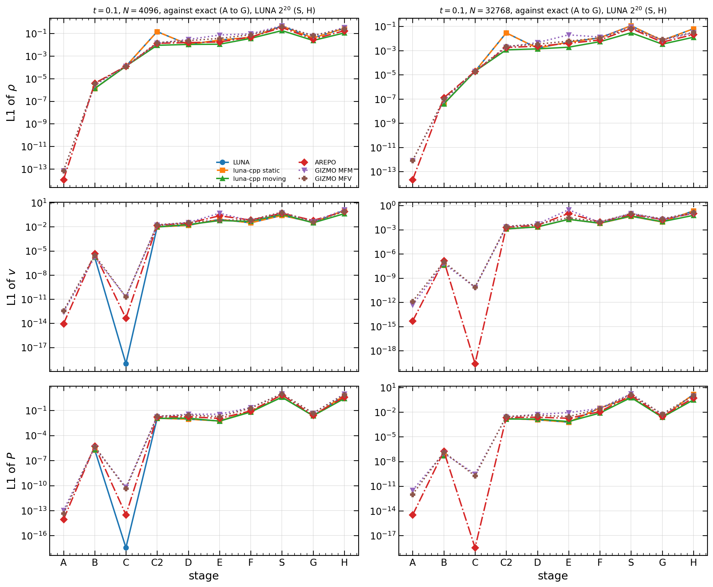

| code, L1 of ρ / v / P over all stages | N = 4096 | N = 32768 |
|---|---|---|
| LUNA = luna-cpp static | 1.02 / 1.53 / 10.0 | 0.231 / 0.305 / 2.12 |
| luna-cpp moving | 0.386 / 0.955 / 6.71 | 0.0571 / 0.151 / 0.916 |
| AREPO | 0.644 / 1.69 / 11.5 | 0.111 / 0.322 / 1.61 |
| GIZMO MFM | 1.10 / 2.51 / 20.0 | 0.168 / 0.548 / 2.72 |
| GIZMO MFV | 0.894 / 1.71 / 18.0 | 0.134 / 0.315 / 2.51 |

The Riemann solver (AREPO uses its exact solver: with HLLC it stops in the first step), limiters, time integrators and mesh regularisation are each code's own. The walls are matched by a mirror image of the tube. Details and the final states are in luna-reference-solutions (`arepo/super_tube/`, `gizmo/super_tube/`). Neither code reached t = 2: AREPO stops with a NaN velocity at t = 0.53 (N = 4096), and GIZMO MFM's time step falls to 6·10⁻⁸ at t ≈ 0.91, both in stage E's swept-up thin gas.

Version 2 (`super-tube-v2`, research_notes/super_tube_v2_2026-11-18.md; preliminary: the moving mesh's run to t = 4 at N = 32768 is still running) keeps these stages and adds five of the hardest known 1D problems, to t = 4 on [0, 40.25]:
- cold gas at Mach 10⁴ leaving through the open wall;
- a jump with a density ratio of 10⁶ and a pressure ratio of 10¹²;
- Shu-Osher;
- Noh's cold colliding streams;
- a true vacuum.

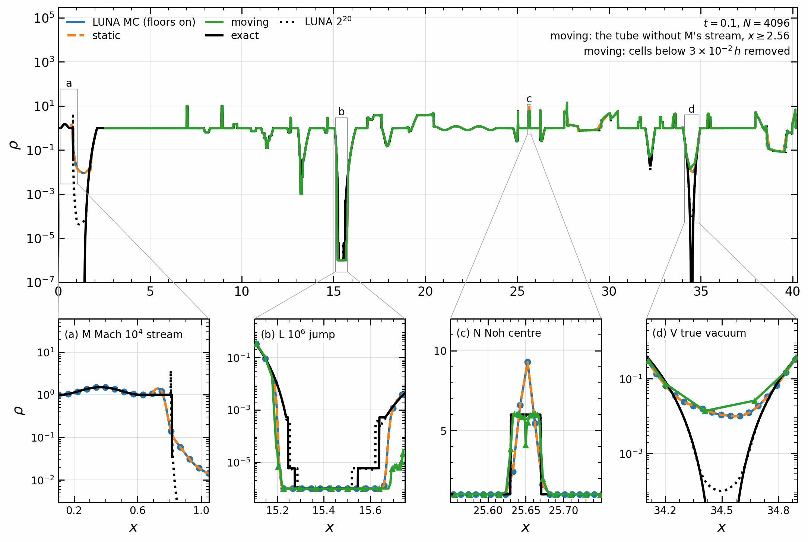

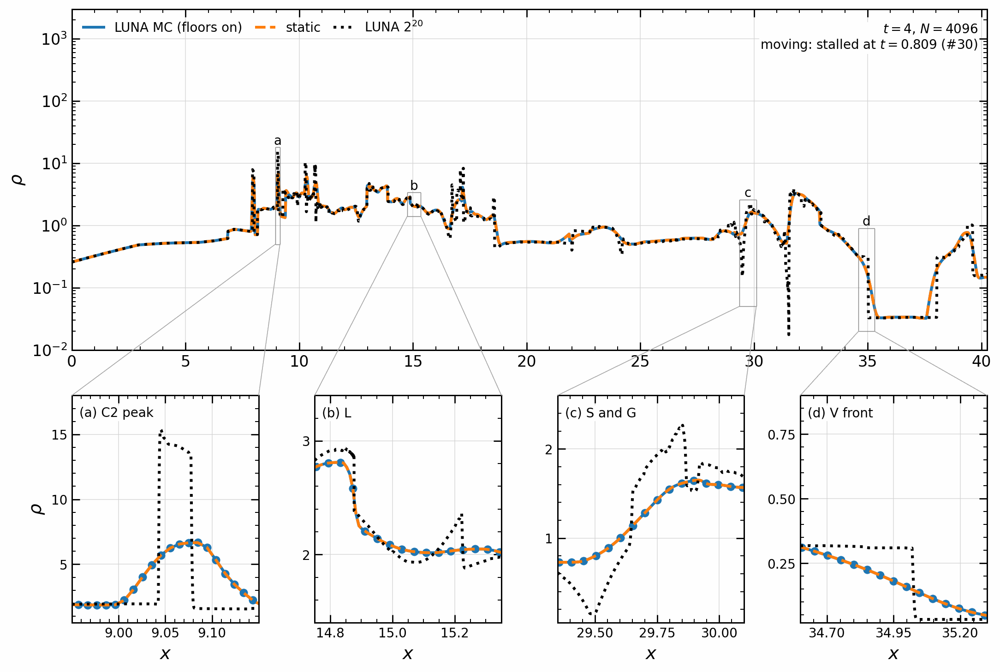

The whole v2 tube at N = 4096: LUNA (floors on), static and moving against the exact solution (t = 0.1) and LUNA's run at 2²⁰ cells, with zooms below. Moving is the tube without the Mach 10⁴ stream, drawn where the two are the same. At t = 4 it stalled at t = 0.81 (#30). Below, the same at N = 32768; there the moving run to t = 4 is still running.

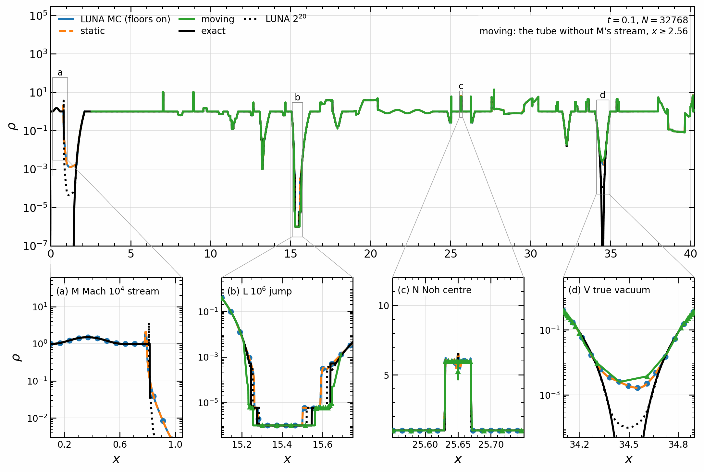

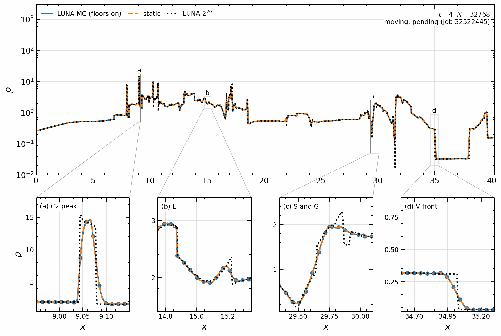

At t = 0.1 the moving mesh is level with static or ahead in every stage except the Mach 10⁴ stream. It cannot run that stream at all: cells cannot leave through the wall ([#14](https://github.com/Ulli1991/luna-cpp/issues/14)), and the resulting NaN state is reported as reaching the end ([#29](https://github.com/Ulli1991/luna-cpp/issues/29)). Without that stream it stalls at N = 4096 at t = 0.81, its points collapsing onto a contact in the 10⁶ density jump ([#30](https://github.com/Ulli1991/luna-cpp/issues/30)). LUNA reaches t = 4 with its positivity floors on (`preserve_face_states`, off by default). Without them its pressure goes negative in the Noh stage after t ≈ 0.32 at N = 4096 and 32768. LUNA at 2²⁰ serves as the reference, and our static mesh at 2¹⁹ lies within 3.5·10⁻² of it in every stage.

Density in three of the new stages at t = 0.1 (top) and t = 4 (bottom), at N = 4096 (left) and 32768 (right): the 10⁶ density jump, Noh's colliding streams and the true vacuum. The other stages are in `docs/figures/super_tube_v2_*.png`.

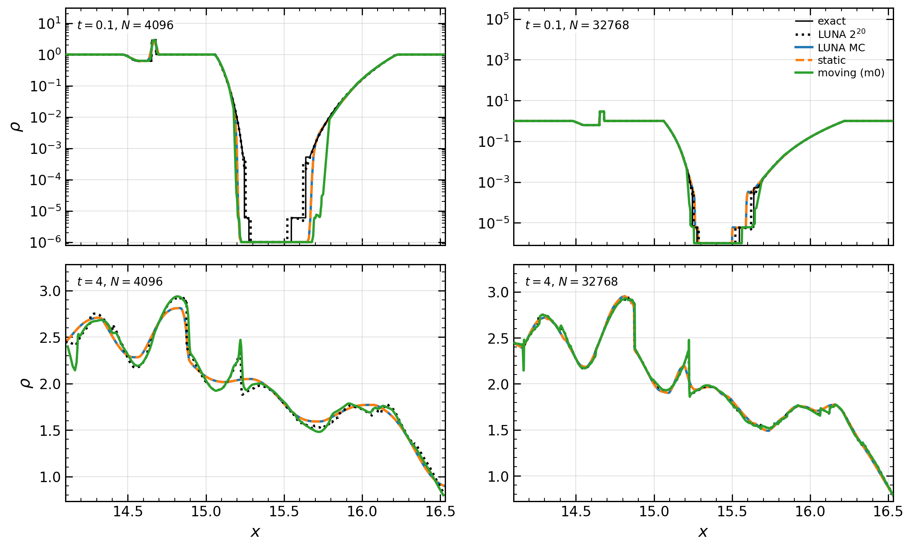

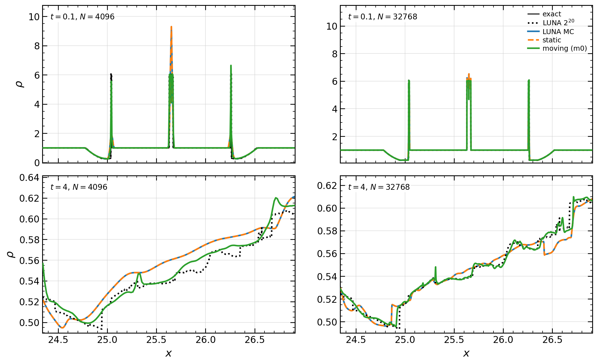

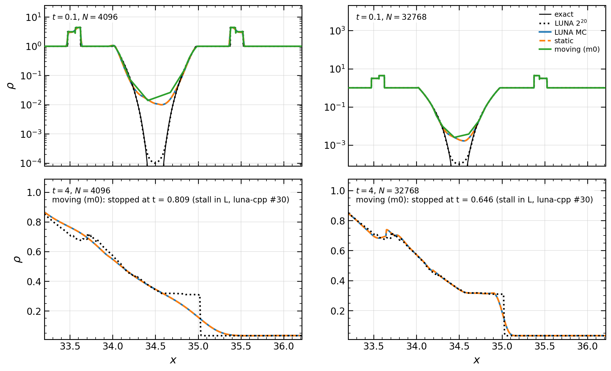

### All 30 tests against resolution

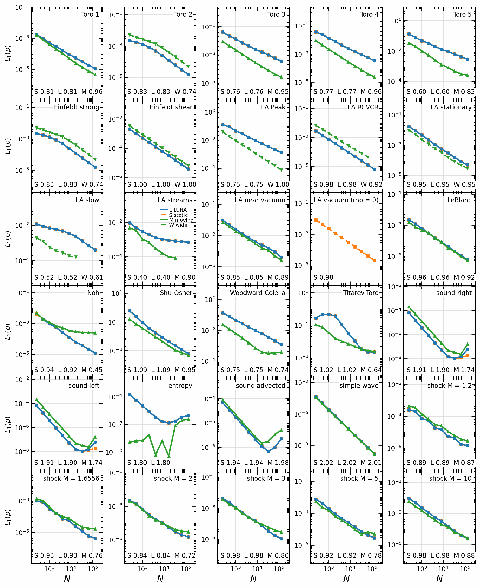

The density error against the number of cells for every 1D test, with the order at the bottom of each panel (S static, L LUNA, M moving, W moving on a wide line). Static and LUNA agree everywhere. The moving mesh is ahead on most shock tests, often by an order of magnitude, behind on Noh, and second order on the sound waves; on the entropy wave, which the moving points carry exactly, it stays at rounding, below 1e-7.

## Results in 2D

### Kelvin-Helmholtz instability

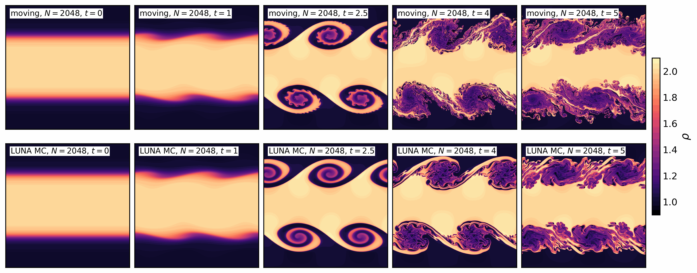

Two shearing layers whose interface rolls up into billows (McNally, Lyra & Passy 2012), at t = 0, 1, 2.5, 4 and 5, moving mesh against LUNA, both N = 2048. They agree up to the first roll-up. Past t = 2.5 secondary instabilities set in earlier on the moving billows; neither run is converged there.

### The moving mesh inside a billow

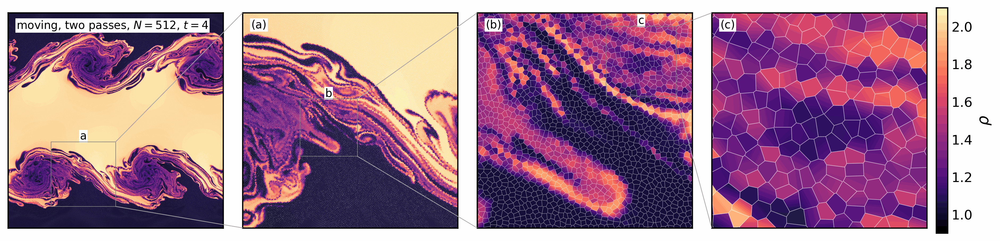

The moving mesh at t = 4 (N = 512): the whole box and three nested zooms into one billow, with the exact Voronoi cells drawn over the density. Cells stretch and gather along the rolled-up layers.

### Density against LUNA

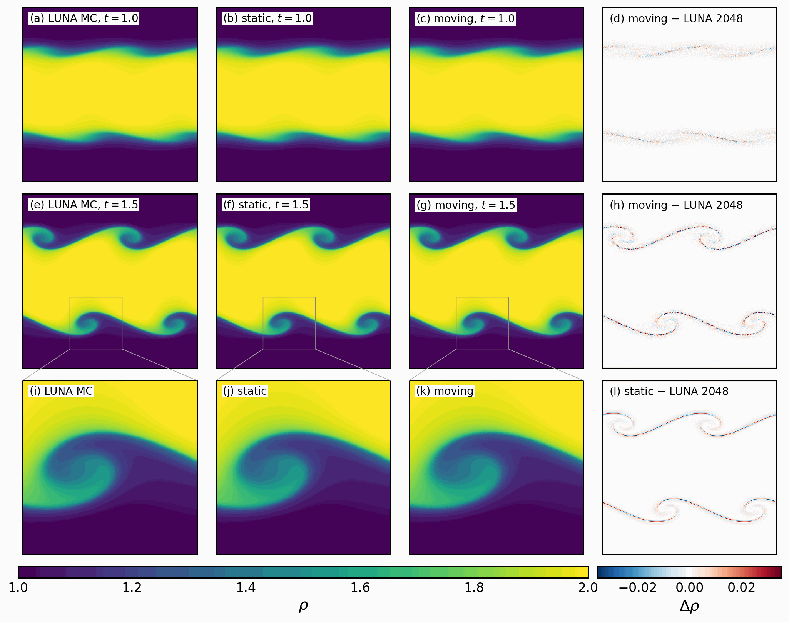

Density at t = 1.0, 1.5, 2.5 and 3.0 for LUNA, static and moving (N = 2048), with the differences from LUNA. Static stays close to LUNA throughout (mean difference 4e-8 at t = 1 to 6e-4 at t = 3). The moving billows stop matching after t = 1.5 (0.012 at t = 2.5).

### Growth of the instability

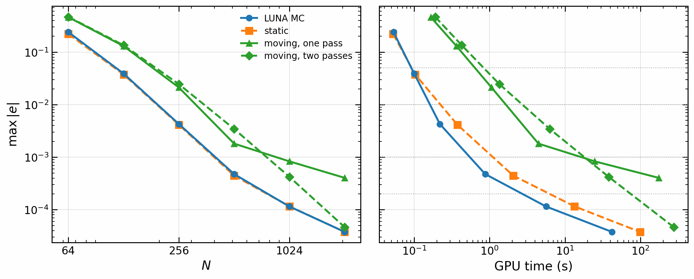

The error of the instability's growth against the published reference curve, for N² cells. LUNA and static lead at the same N, and LUNA in GPU time. Moving with a single flux at the half step (removed) stalled near 4e-4; the moving step on both meshes recovers.

## Results in 3D

### Yee vortex

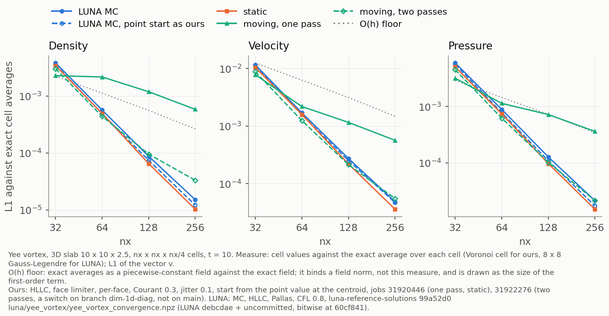

A smooth isentropic vortex carried for ten time units, the standard test of order on smooth flow. With a single flux at the half step (removed) the moving mesh was first order; on both meshes it reaches order 2.2, then 1.5, close to static.

### Sedov blast

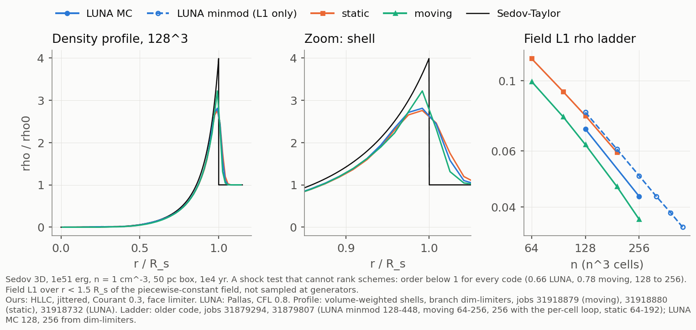

A point explosion (1e51 erg, n = 1 cm⁻³, 50 pc box, 1e4 yr). It tests shock capturing and the moving mesh's response to strong expansion, but cannot rank schemes: every code converges below first order (0.66 LUNA, 0.78 moving). Left, density in shells at 128³; right, error against resolution. These moving runs used a single flux at the half step, removed since.

### Sedov at 256³ against LUNA

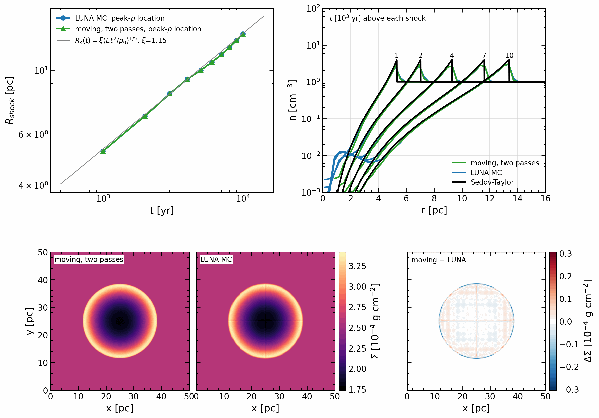

Shock radius, density profiles at five times and the column density, against LUNA and the Sedov-Taylor solution. The two codes agree to 0.2 % on average, with up to 9 % of the peak at the shock. Both peaks sit below Sedov-Taylor because 256³ is coarse.

### Radial profiles

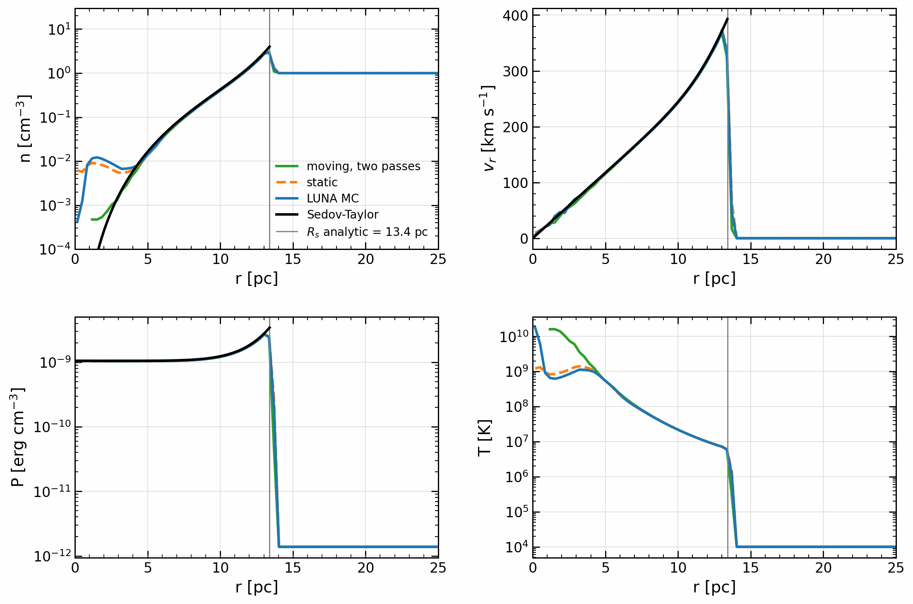

Density, velocity, pressure and temperature at 1e4 yr. The moving mesh follows Sedov-Taylor down to a density of 10⁻³ in the evacuated centre, where both fixed grids level off near 10⁻².

### The mesh at the shell

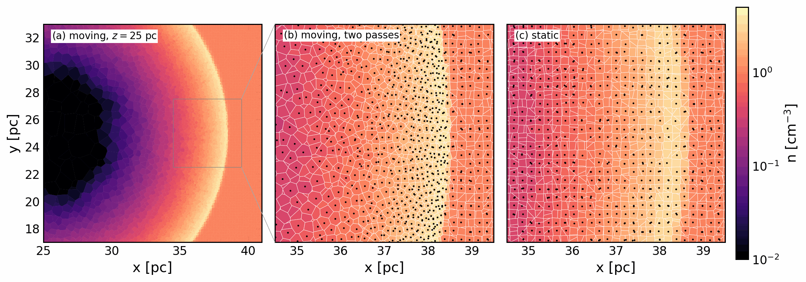

A slice through the 3D mesh at 1e4 yr. The moving cells gather in the shell and open up behind it; the static mesh stays uniform.

## Speed

Ours measured on one A100, SM clock 1305 MHz (sampled every second through the job), Sedov 3D, 40 steps, the median step (static: the wall time of a step; moving: its fenced phases). Static: voronoi-cpp abd3d39, jobs 32525301 and 32526178; moving (whole step, hydro part, memory): voronoi-cpp 1741a1a and the default `grad16` with the precision levers, job 32575043 (2026-11-19; the application clock logged, not sampled). LUNA (Sedov 3D, minmod, HLLC, its Pallas kernel, snapshots off) ran on the same GPU type in another job. G cell updates per second, a cell update being one whole step of one cell; jobs and the remaining rows are in [docs/measurements.md](docs/measurements.md).

| G cell updates/s | 128³ | 256³ |
|---|---|---|
| static mesh, HLLC | 0.226 | 0.233 |
| moving mesh, whole step with the mesh update | 0.091 | 0.099 |
| moving mesh, the hydro part | 0.143 | 0.146 |
| LUNA FP64 | 0.82 | 1.04 |
| LUNA FP32 | 1.46 | 2.35 |
| GPU memory, ours, moving | 2252 B/cell (4.7 GB) | 2252 B/cell (37.8 GB) |
| GPU memory, ours, static | 1135 B/cell (2.4 GB) | 1135 B/cell (19.0 GB) |
| GPU memory, LUNA FP64 | 113 B/cell (0.24 GB) | 80 B/cell (1.34 GB) |
| GPU memory, LUNA FP32 | | 40 B/cell (0.68 GB) |

Per face the gap is smaller: a LUNA cell has 3 faces of its own, ours 7.95, so our static hydro runs 1.80 G face fluxes/s at 128³ against LUNA's 2.46 G in FP64, 73 % of its rate. LUNA's default XLA kernel runs 0.48 FP64 at 128³, the 0.47 earlier versions of this table quoted. Moving Sedov 128³ takes 8.68 GPU seconds to 1e4 yr (349 steps, job 32575043; 9.10 before the precision levers, 9.43 on voronoi-cpp abd3d39, job 32540742; 9.72 before the levers of 2026-11-18, job 32525893).

Memory is in bytes per cell and in GB of 10⁹ bytes throughout. Ours is the peak of all the arrays the code allocates during a step; LUNA's is what JAX reports in use at a progress line (LUNA prints it in GiB, converted here), so it is not a peak and the two measure slightly different things.

### Against resolution

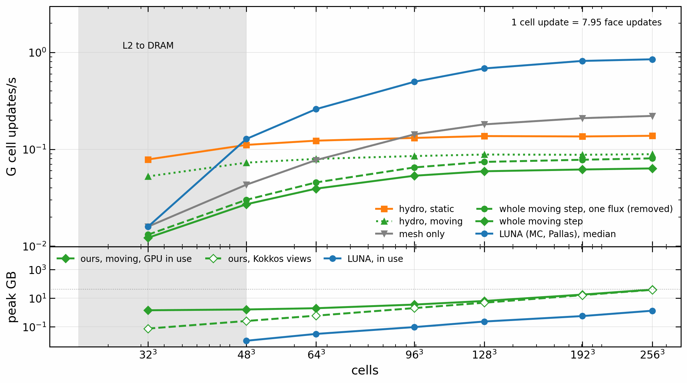

Speed and memory from 32³ to 256³. The hydro is flat from 96³ up; below 64³ the fixed cost per step dominates.

### Precision options

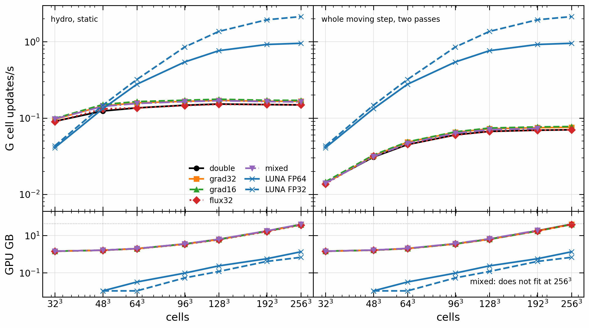

The same sweep for each precision option. The default `grad32` gains 12 % on the static hydro and 8 % on the moving step against double; `grad16` gains a few percent more. None of ours is FP32 throughout, so LUNA's FP32 line is not a like-for-like comparison. `grad32` leaves the error against exact solutions unchanged to four digits on every test checked, and so does `grad16` (28 B/cell less). `single` (float gradients, fluxes and Riemann solve, double geometry) is 10 to 15 % faster than `grad32` with the same Sedov, vortex and 1e-3 sound-wave errors, but a sound wave of amplitude 1e-6 is lost in its rounding; it stays an option (docs/measurements.md).

### 1D, 2D and 3D

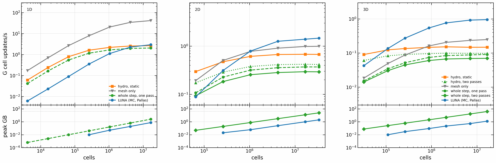

The same blast in each dimension. At the largest size the static hydro runs 2.66, 0.67 and 0.15 G cell updates/s against LUNA's 2.96, 1.46 and 0.95: level in 1D, LUNA 2.2 times ahead in 2D and 6.4 times in 3D, roughly in line with the number of faces per cell. Our 1D is faster than LUNA up to 4M cells.

## Tests

Run times are in [TESTING.md](TESTING.md). The mesh's own tests are in voronoi-cpp.

| Test | Specifies |
|---|---|
| `hydro` | HLLC and HLL fluxes, conservation, bit-identical runs, moving-mesh invariances (bulk velocity, Galilean blast) |
| `hydro_wave` | moving 3D step on smooth flow: Yee's vortex and a sound wave against measured bounds |
| `hydro2d` | 2D hydro, static and moving: uniform states, conservation, sound-wave order, Sod, Noh, a Galilean blast |
| `hydro1d_cases` | every 1D test of LUNA's suite plus two it lacks, 30 in all, against LUNA and the exact solutions, static and moving |
| `hydro1d` | 1D hydro: conservation, inflow, cells from a wall with the budget through it, Sod against the exact solution; LUNA's final states of Sod, Shu-Osher and Woodward-Colella at N = 16 to 1e-12 |
| `grid` | the fixed grid: LUNA's per-axis HLLC and HLL cores against `flux()`, uniform states on every boundary, conservation, the CUDA kernel against the Kokkos kernel bit for bit, and LUNA's own steps (25 cases in `src/test/data/luna_grid`, from `scripts/luna_grid_bits.py` on an A100) bit for bit without FMA contraction, to 1e-12 with it |
| `hydro_derivatives` (opt-in) | the hand-written tangents and adjoints of the 3D hydro (primitive, half step, HLL, HLLC, the limited gradient, a whole static step): tangent against central differences away from switches, adjoint against tangent by the dot test |

```sh
ctest --test-dir build-cuda --output-on-failure
OMP_NUM_THREADS=1 ctest --test-dir build-omp
```

CI (`.github/workflows/checks.yml`) runs clang-tidy (ordinary build) and the CPU tests (ordinary and sanitizer builds) against a pinned Serial Kokkos 5.0.2, with the submodule checked out. It does not run GPU jobs.


## Limitations

- **Speed.** The moving hydro takes 7.6 ns per cell at 128³, 2.4 times its target of 3.1 ns (faster than the mesh, and LUNA's FP64 rate per face). Today's data flow, with face rows and fluxes stored and read back, has a floor of about 3900 B/cell, 3.1 ns at 80 % of the A100's bandwidth, so the target needs fewer bytes, not only better kernels; the flux kernels use no local memory since 2026-11-18 (HLLC took its upwind state by a reference to one of two arrays, which put both in local memory); the gradient sweep uses none either and is latency-bound at a quarter of the warps active (114 registers); its list walk loads the next entry ahead, 4 % off the sweep phase. Every hydro change measured since 2026-11-18 has a row in [docs/tried.md](docs/tried.md).
- **1D moving mesh:** Woodward-Colella stalls near N = 2¹⁵; nothing removes points where gas leaves through an open wall.
- **2D and 3D moving mesh on smooth flow:** on a jittered mesh, which the regularisation relaxes, the density carries an error that does not fall with N: about 3e-8 in 2D (jitter 0.4) and 1.5e-6 in 3D (jitter 0.25), the same with or without the grid fix, so not rounding; its cause is open. It is invisible at the usual amplitudes and decides the error of a 1e-3 sound wave in 3D from nx = 96. On a lattice the moving mesh equals static.
- **Boxes:** periodic only in 3D and 2D; only 1D has walls.
- **Memory:** a moving 256³ run uses 41.3 of the 42.4 GB of a 40 GB A100 (2366 B/cell); a re-sort (`--every`) does not fit beside it; a static run peaks at 2172 B/cell while the mesh is built and the hydro set up, though its steps need 1135; `--precision=mixed` does not fit a moving 256³ run on a 40 GB A100; a forced rebuild beside a moving 256³ run runs out of memory ([#11](https://github.com/Ulli1991/luna-cpp/issues/11)).
- **Bits:** CPU builds can differ from the GPU in the last bits for some modes; A100 runs are identical run to run.
- **Open bugs:** stuck flips at 256³ ([#8](https://github.com/Ulli1991/luna-cpp/issues/8): still seen, now handled. Moving Sedov 256³ to 1e4 yr sticks now and then: in one of four runs here, one step with 6 stuck entries. Since abd3d39 voronoi-cpp repairs such a step locally on the device, and that run ended with the same bits as the others. Why the repair sticks is not investigated.); NaN from zero-area faces on an exact lattice ([#6](https://github.com/Ulli1991/luna-cpp/issues/6)). Mesh bugs are listed in the [voronoi-cpp README](https://github.com/Ulli1991/voronoi-cpp#limitations-and-open-items).

## Roadmap

Done: 3D, 2D and 1D hydro on the exact mesh, one moving step (MUSCL-Hancock on both meshes) in every dimension, a first round of speed work, `grad16` and the moving-mesh precision levers in 3D.

1. One `main` and one general runner for 1D, 2D and 3D, reading a LUNA-style parameter file ([#18](https://github.com/Ulli1991/luna-cpp/issues/18)).
2. Hydro speed: the moving hydro below 3.1 ns per cell: fluxes summed where they are computed instead of stored, and a gradient sweep that hides its load latency.
3. A standing 3D test suite against LUNA ([#7](https://github.com/Ulli1991/luna-cpp/issues/7)).
4. Time integration study: RK2 with PLM against MUSCL-Hancock, and how the mesh should move within a step ([#1](https://github.com/Ulli1991/luna-cpp/issues/1)).
5. Local time steps ([#9](https://github.com/Ulli1991/luna-cpp/issues/9)), multi-GPU, refinement, self-gravity, and autodiff ([#12](https://github.com/Ulli1991/luna-cpp/issues/12)).

More ideas, each with a first test: [docs/ideas.md](docs/ideas.md).

## Repository layout

- `src/hydro/`: the solver, header-only: `precision.hpp`, `euler.hpp` (gas and fluxes), `finite_volume.hpp` (2D and 3D), `finite_volume_1d.hpp`, the fixed grid (`grid.hpp`, `grid_finite_volume.hpp`, `grid_cuda.hpp`), and the initial conditions and snapshots.
- `src/bench/`: the programs `hydro_sedov`, `hydro_1d`, `hydro_wave3d`, `hydro_kh2d`.
- `src/test/`: the tests.
- `extern/voronoi-cpp/`: the mesh library, a pinned submodule with its full source.
- `scripts/`: run scripts for the A100, figure scripts (`make_figures.py`, LUNA's `figstyle.py`), lint.
- `docs/`: figures, `design.md`, `measurements.md`, `ideas.md`.
